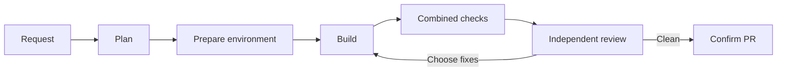

# sprowt harness

A local coding harness with terminal and native macOS interfaces that takes a software change from a request to a checked, reviewed pull request. Codex and Muse work in isolated Linux environments; you follow the work and step in when a decision needs you.

**[Get started →](docs/quickstart.md)** · [Documentation](docs/README.md) · [Troubleshooting](docs/troubleshooting.md)


*Rendered terminal layout with sample tasks and results.*

## From request to PR

1. **Describe the outcome.** The planner reads your project and splits the work into tasks with file scopes, dependencies and checks.
2. **Follow the work.** The controller prepares the environment and records baseline tests. Up to two executors work in parallel. Read the plan and messages in **Conversation**, then switch to **Changes**, **Checks**, **Findings** or **Agents** for evidence.
3. **Verify and review.** The harness reruns checks against the combined changes. A fresh reviewer examines that version. Findings have owners and explicit fix or investigation actions.
4. **Publish when ready.** Passing checks and a clean current review unlock publication. A model writes a concise commit title and PR summary from the diff. Preview the text, confirm publication, then keep editing to update the PR. Review comments and failing GitHub checks on the open PR appear beside the local evidence while the harness is open.



Stalled repairs stop with evidence and a next action. Reopening restores saved work; you choose when unfinished work resumes.

Agents receive the same [pinned coding skills](docs/skills.md) on new and resumed work. Role instructions cover planning, implementation and correctness plus structural review.

## Run it

Requires Apple silicon, macOS 26+, Rust, Apple Container and the supported Codex CLI. Muse is optional; Sprowt manages its tested release automatically. Follow the [quickstart](docs/quickstart.md) for login and first-time setup.

From this repository:

```sh
cargo install --path . --locked --force
```

Then, from the project you want to change:

```sh
sprowt-harness
```

For the native SwiftUI app, build with Xcode 26 or newer:

```sh
./macos/build.sh
open target/macos/Sprowt.app
```

Both interfaces have the same five workspace views, with the composer available while you inspect evidence. The native sidebar and terminal project picker group codemods under collapsible projects. Agents keep running as you switch projects; background activity and requests stay visible in the project list. Both use the same Rust engine, saved work and [System, Light or Dark appearance](docs/appearance.md). Close one before opening the same project in the other. See the [macOS guide](docs/macos.md).

## Find what you need

| I want to… | Read |
| --- | --- |
| Make my first PR | [Quickstart](docs/quickstart.md) |
| Use the native app | [macOS guide](docs/macos.md) |
| Switch workspace views and inspect results | [Terminal guide](docs/terminal.md) |
| Send edits, steer workers or reopen work | [Codemods and messages](docs/codemods.md) |
| Reuse a project's setup commands | [Environment recipe](docs/environments.md#add-a-project-recipe) |
| Understand or fix review findings | [Review and repairs](docs/review.md) |
| Recover from a failure | [Troubleshooting](docs/troubleshooting.md) |
| Understand where code and agents run | [Architecture](docs/architecture.md) |
| Contribute to the harness | [Development](docs/development.md) |
| Use the pinned coding and review standards | [Coding skills](docs/skills.md) |

## Scope

Worker execution and review run in Linux; building macOS and iOS projects through workers is not supported. Downloads use a domain allowlist; additional access needs your approval. GitHub publication is supported, with one harness instance per project. See [sandbox boundaries](docs/sandbox.md) and [local data](docs/local-state.md).

This is a learning project, built one layer at a time. It is independent of sprowt.finance.
