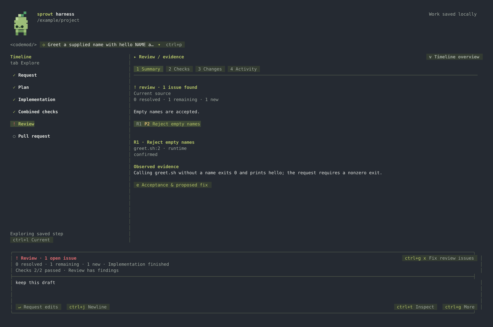
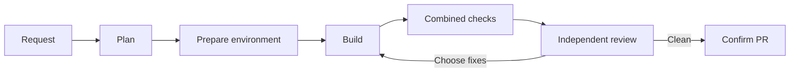

# sprowt harness

A local terminal app that takes a software change from a request to a checked, reviewed pull request. Codex and Muse work in isolated Linux environments; you follow the timeline and step in when a decision needs you.

**[Get started →](docs/quickstart.md)** · [Documentation](docs/README.md) · [Troubleshooting](docs/troubleshooting.md)



*Layout illustration. Worker names, tasks and results are examples.*

## From request to PR

1. **Describe the outcome.** The planner reads your project and splits the work into tasks with file scopes, dependencies and checks.
2. **Prepare and follow the work.** The controller checks project setup and records baseline results before editing. Up to two Codex or Muse executors work in parallel. The timeline shows progress; Details shows commands, results and failures.
3. **Verify and review.** The harness reruns checks against the combined changes. A fresh reviewer examines that version. Findings have owners and explicit fix or investigation actions.
4. **Publish when ready.** Passing checks and a clean current review unlock publication. A model writes a concise commit title and PR summary from the diff. Preview the text, confirm publication, then keep editing to update the PR.



Repairs have limits. A pass that makes no progress stops with its evidence and a next action. Blocked diagnostic prerequisites offer a revised repair plan. Reopening restores saved work without restarting unfinished workers.

## Run it

Requires Apple silicon, macOS 26+, Rust, Apple Container and the supported Codex CLI. Muse is optional. Follow the [quickstart](docs/quickstart.md) for versions, login and first-time setup.

From this repository:

```sh
cargo install --path . --locked --force
```

Then, from the project you want to change:

```sh
sprowt-harness
```

## Find what you need

| I want to… | Read |
| --- | --- |
| Make my first PR | [Quickstart](docs/quickstart.md) |
| Navigate the timeline and inspect results | [Terminal guide](docs/terminal.md) |
| Send edits, steer workers or reopen work | [Codemods and messages](docs/codemods.md) |
| Understand or fix review findings | [Review and repairs](docs/review.md) |
| Recover from a failure | [Troubleshooting](docs/troubleshooting.md) |
| Understand where code and agents run | [Architecture](docs/architecture.md) |
| Contribute to the harness | [Development](docs/development.md) |

## Scope

Execution and review run in Linux. Native macOS and iOS builds are not supported. Downloads use a domain allowlist; additional access needs your approval. GitHub publication is supported, with one harness instance per project. See [sandbox boundaries](docs/sandbox.md) and [local data](docs/local-state.md).

This is a learning project, built one layer at a time. It is independent of sprowt.finance.

[Project preparation](docs/environments.md) uses saved setup recipes and capability probes. Stalled work keeps its failed-attempt evidence and observed time by phase in [Activity](docs/terminal.md#details), including across replacement plans.
