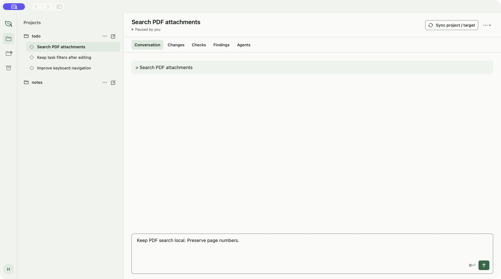
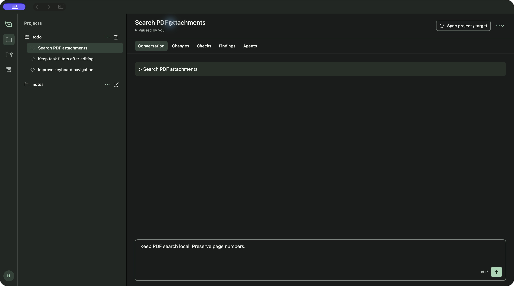

[Docs](README.md) / Use Sprowt

# Choose an appearance

Choose **System**, **Light** or **Dark**. Sprowt saves one preference for all projects in the shared database, so it follows you between the app and terminal.

| Interface | Change the preference |
| --- | --- |
| macOS app | Use **Appearance** in the bottom profile menu, or **Sprowt → Appearance** when the sidebar is hidden. |
| Terminal | Press **Ctrl+G**, then **A** for **Appearance**. Select with **↑ / ↓**, then press **Enter** to apply or **Esc** to cancel. |

You can change the appearance before creating a codemod. Your draft, caret and selected workspace view stay in place. If saving fails, Sprowt reports the error and keeps the previous preference.

**System** follows macOS appearance in both interfaces. The terminal checks for changes at most once every two seconds. On other operating systems it uses `COLORFGBG` when available: background 7 or 15 selects light, other values select dark. Without that hint it uses dark; choose **Light** explicitly if needed.

Both themes use evergreen accents, paper or charcoal backgrounds, and the same status colors. Blue means work is running, amber means Sprowt needs your input, red marks an error, and green marks completed work. Text and symbols also identify the status.

The native app uses the macOS system font and preferred text sizes. Code uses a system monospace font. The CLI keeps your terminal's font and text size and paints its own background for readable text in either theme.

The [local state guide](local-state.md) describes where the preference is stored. An alternate desktop `--data-dir` has its own preference.
