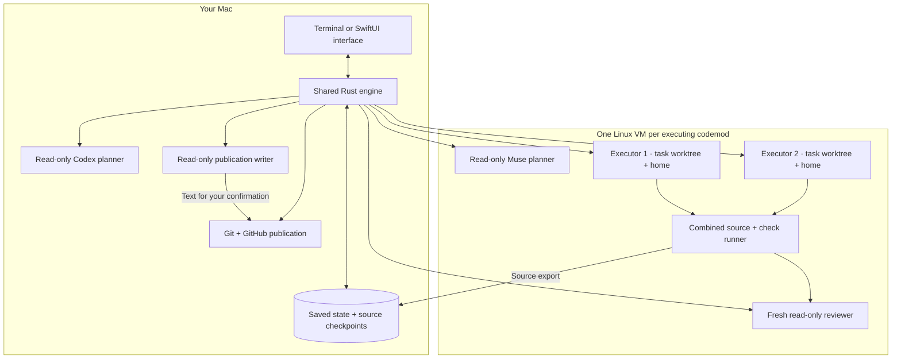
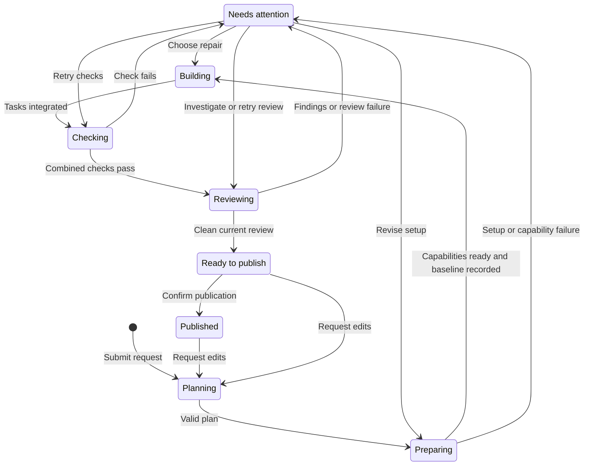

[Docs](README.md) / Understand the system

# Architecture

Rust owns the workflow. Agents propose plans, make scoped changes and report evidence. The controller validates that evidence and decides which transition is allowed.

## Where things run

The diagram illustrates two executors; the saved [worker team](workers.md#choose-a-worker-team) controls the actual count and role models. Source is copied into the VM. Host project folders and Git credentials are not mounted there. The production Codex connection keeps its app server on the host and sends execution into Linux; Muse runs its CLI in Linux behind a host credential broker.

The terminal calls the Rust engine directly. The SwiftUI app starts a bundled copy of the Rust executable and exchanges typed commands and state snapshots over local stdin/stdout. A shared Rust session owns one Engine per opened project and selects which workspace is visible. Each Engine retains its workers, jobs, preparation, drafts, navigation and ownership lock. The session polls all opened projects; switching never reloads a live Engine. One controller owns each project at a time; both interfaces reuse the same saved state. See the [macOS guide](macos.md#switch-between-interfaces).

## Responsibilities

| Component | Owns | Read more |
| --- | --- | --- |
| Terminal | Workspace views, evidence inspection, drafts and contextual actions | [Terminal](terminal.md) |
| macOS interface | Native project picker, codemod views, composer and confirmations | [macOS app](macos.md) |
| Shared session and project engines | Visible project selection, background polling, workflow transitions, allowed actions and runtime lifetime | [Development](development.md#source-map) |
| Planner | Contracts, tasks, scopes, dependencies and checks | [Planning](planning.md) |
| Scheduler | Ready tasks, configured active limit and saved model assignments | [Execution](execution.md) |
| Executors | Implementation within a task folder; repeatable check commands | [Workers](workers.md) |
| VM controller | Environment recipes, capability probes, baselines, checkpoints and independent checks | [Environments](environments.md), [Sandbox](sandbox.md) |
| Reviewer | Fresh assessment, finding triage and explicit closure decisions | [Review](review.md) |
| Publication writer | Commit title, PR title and summary from the reviewed diff | [Publication](git-workflow.md#commit-and-pr-text) |
| Tool dispatcher | Caller validation and host/guest operation boundaries | [Tools](tools.md) |
| Skill bundle | Pinned instructions, role policies and read-only host/VM delivery | [Coding skills](skills.md) |
| Store and Git adapters | Durable state, recovery checkpoints and confirmed publication | [Local state](local-state.md), [Git workflow](git-workflow.md) |

The controller serializes checkpoints, source replacement, integration and system package installation. Independent task preparation and controlled checks use separate process connections with fixed task paths and runtime homes. Final combined checks remain fresh and serialized. Review repairs run one owner at a time.

## The workflow

Bounded automatic recovery happens inside this flow. User pauses, missing permission, uncertain delivery and exhausted repair budgets stop advancement. Reopening never restarts unfinished work automatically.

## Evidence follows the source

Task completion, combined verification, review and publication are separate facts:

1. A worker returns commands for every declared check.
2. Rust runs those commands and accepts the task only if its source remains unchanged.
3. All tasks' checks run against the integrated version.
4. A fresh reviewer examines that version and the saved finding ledger.
5. Publication requires passing checks and a clean review for the current source.

Changing source invalidates previous evidence. Saved results stay readable as history. A PR can remain open while newer local changes still need verification.

## Boundaries today

- Linux execution only; native macOS and iOS builds need another backend.
- Codex planning is read-only on the host; Muse planning and independent review read VM source. Read-only VM roles deny external network access.
- Downloads pass through an allowlist. Workers can request access; only you can approve it.
- External MCP servers, runtime plugins, shared memory and repository indexing are not connected.
- GitHub publication is supported; PR merging remains outside the harness. Open-PR reviews, unresolved threads, comments and failing checks are polled read-only on the host with the target check and shown as evidence. Items the user selects enter the review ledger as unconfirmed findings for fresh-review triage before any repair; replying to or resolving threads on GitHub is not connected.

**Next:** [How tasks are planned](planning.md) · [How checks establish completion](execution.md)
