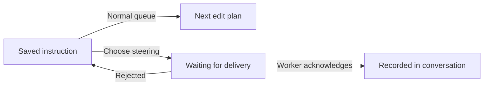

[Docs](README.md) / Use the harness

# Codemods and messages

A codemod is one goal in one project. It keeps its own plan, conversation, queue, draft, branch and working environment. Switching codemods does not stop the others' workers.

## Create and manage work

Open **Ctrl+P** to select a codemod.

Use **Alt+←** and **Alt+→** to revisit codemods or an unfinished creation draft in the current session. The [macOS app](macos.md#work-on-a-project) provides **Back** and **Forward** with **⌘[** and **⌘]**. Both preserve instruction drafts and the unsent creation description. Choosing another destination after going back replaces the forward path. Closed codemods remain readable; deleted codemods leave the history. Opening a project starts fresh navigation history.

| Action | How | Result |
| --- | --- | --- |
| Create | Choose **New codemod**, describe it, press Enter | Planning and execution start after any required Git confirmation |
| Switch | Select an active codemod, press Enter | Its conversation and draft return |
| Read closed history | Tab to closed codemods, press Enter | Opens saved work without reopening |
| Close | Select an active codemod, press `c`, confirm | Checkpoints source and removes its VM; history stays |
| Reopen | Tab to closed codemods, select one, press `r` | Restores source; unfinished work waits for resume |
| Delete | Select a codemod, press `d`, confirm | Removes local records and unpublished work; an existing PR stays |

The planner generates a short title from your request in the same planning turn. Until the plan is ready, the codemod appears as **New codemod**. The full request stays in its conversation. Existing saved names stay unchanged until you request a new plan.

The request can use Markdown headings, emphasis, lists, checklists and code. In the terminal's new codemod composer, **F2 · Format** opens helpers for those formats. A `/` on an empty line opens the same menu. Choose with **↑**, **↓** and **Enter**, or click a choice. **Esc** closes the menu without removing its slash; continuing `/Users/...` keeps the literal path.

**Ctrl+J** adds a newline. **Enter** creates the codemod outside the formatting menu. **Ctrl+Z** undoes edits; **Ctrl+Shift+Z** or **Ctrl+R** redoes them. Wrapping text or formatting several lines can require more than one undo. **Esc** cancels creation, or quits when there is no codemod.

The [macOS creation editor](macos.md#work-on-a-project) displays the supported formats and provides system dictation. Terminal dictation depends on the terminal application's macOS support. Dictated or pasted multiline text only edits the draft; it never submits automatically.

See [Git workflow](git-workflow.md) for starting files, publication and checkpoint recovery. After a PR is merged or closed, create a new codemod from the updated project.

## Send an instruction

The composer hint tells you what **Enter** will do.

| Hint | What happens |
| --- | --- |
| **Create codemod** | Starts a new requested outcome |
| **Queue for next pass** | Saves an instruction until the current version passes verification |
| **Request edits** | Starts a new plan against the saved source when eligible |
| **Answer #ID** | Answers that worker's question and allows it to resume |

A draft is unsent text. A queued instruction is saved but not yet part of a new edit round. Conversation history records consumed requests and worker replies. These remain separate so editing a queue item does not overwrite your draft.

After a failed run, sending edits replans against the saved work, including unfinished changes. Deliberately paused work keeps its queue until you resume. Further edits to a published codemod update the same open PR after fresh checks and review.

## Manage the queue

Press **Ctrl+Q**.

| Key | Action |
| --- | --- |
| ↑ / ↓ | Select an instruction |
| Enter | Edit it; Enter saves and Esc cancels |
| `k` / `j` | Move it up / down |
| `d` | Remove it |
| Space | Mark or unmark instructions |
| `t` | Choose a running worker or all workers as the steering target |
| `s` | Send selected instructions to workers, or wait for a connection |
| Esc | Return to the composer |

Removing the last actionable item closes the dialog. Your draft stays intact. Instructions awaiting delivery confirmation cannot be edited, removed or sent again.

## Steer an active turn

Use steering when an instruction should reach a worker during its current task.

1. Submit the instruction, then open **Ctrl+Q**.
2. Select it, or mark several with **Space**.
3. Choose the worker with **t**, then press **s**.

Instructions keep their queue order. A broadcast stays pending until every selected worker acknowledges it. If a turn has ended and delivery is rejected, the instruction returns to the normal queue once. Unknown delivery stays saved for reconciliation; it is not silently sent twice.

Without a connected worker, steering waits for a task to start. Reordering the queue never delivers an instruction.

**Next:** [Answer worker questions](coordination.md#questions-for-you) · [Inspect progress](terminal.md) · [Fix review findings](review.md)
