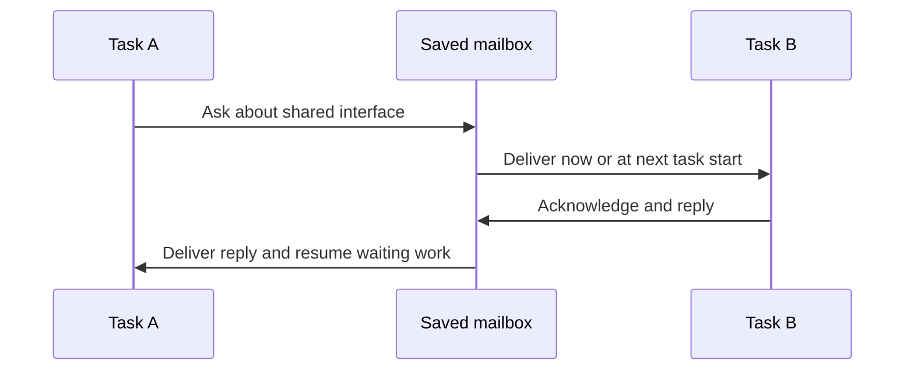

[Docs](README.md) / Understand the system

# Worker communication

Workers in one codemod share saved task mailboxes. They ask questions, reply and send updates while keeping separate file ownership. Rust routes messages to the current owner of the recipient task.

## When workers coordinate

The planner links tasks around shared interfaces, assumptions and handoffs. Each worker sees relevant peers, their scopes and topics. A link from either task appears to both; it is separate from a scheduling dependency.

Workers send material changes, blockers and completed handoffs. They ask when necessary information is missing and continue independent work while waiting. You do not need to prescribe a task split or request routine messaging.

## Questions for you

Questions appear beside the composer with the sender and message ID. When the hint says **Answer #ID**, Enter answers that question instead of queueing an edit. Answer multiple questions in their displayed order. An arriving question preserves your draft.

Unanswered asks prevent task completion. Once answered, a waiting task resumes in its existing folder. Independent tasks can keep running. Reopened projects wait for explicit resume.

**Ctrl+O** shows peer topics. **Ctrl+T → Tasks** shows task context; Activity retains routine messages and narration.

## Delivery states

| State | What it proves |
| --- | --- |
| Saved | The message exists in the host database |
| Delivered | The provider accepted the injection |
| Acknowledged | The recipient called the receipt tool |
| Answered | A reply was saved |

None of these means source passed verification. Confirmed deliveries are not repeated on reconnect. Unknown delivery pauses for explicit retry. A Muse dispatch log can prove an update was never sent; that update remains queued or in the inbox. Rejected injections remain available for a later read.

A late acknowledgement cannot replace a valid task report with an empty result. Workers retain declared check commands or report a blocker; Rust independently verifies the selected result.

## Worker tools

| Tool | Purpose |
| --- | --- |
| `send_worker_message` | Send an `ask`, `reply` or `update` to a task ID; asks can target `user` |
| `read_worker_messages` | Read inbox, sent messages, assignments and relevant peer scopes/topics |
| `ack_worker_messages` | Acknowledge specific inbox IDs |

Replies reference the original ask. Stable keys make repeated sends idempotent. Rust binds codemod and worker identity; model arguments cannot impersonate a peer. Messages carry context and cannot change scope, permissions or the user's goal.

See the [ask, acknowledgement and reply payloads](tools.md#coordinate-with-another-task).

## Limits and retention

- Messages stay within one codemod and follow current task ownership, including unassigned tasks.
- Asks to unavailable tasks or those creating a wait cycle are rejected.
- Bodies allow 4,000 bytes, with up to 32 unacknowledged messages per task.
- SQLite stores message bodies as local plain text.
- New edit and integration rounds retain history but retire old task addresses.
- Closing keeps mailboxes; deletion removes them.

A mailbox message alone cannot restart completed work. Defects discovered after an owner finishes use a validated [repair handoff](execution.md#automatic-repairs).

**Next:** [Steer workers yourself](codemods.md#steer-an-active-turn) · [Tool boundaries](tools.md)
