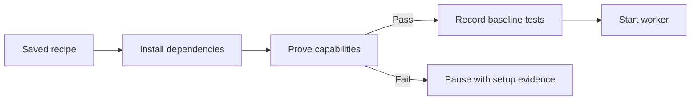

[Docs](README.md) / Understand the system

# Project preparation

Before a task starts editing, the controller prepares its Linux environment and records the starting test results. Codex and Muse use the same preparation path.



## Where the recipe comes from

The planner reads project manifests and supplies setup commands, capability probes and baseline checks.

| Available recipe | Used by the controller |
| --- | --- |
| Explicit recipe in the accepted plan | The plan's recipe, including corrections made during replanning |
| No plan recipe, but `.sprowt/environment.json` exists | The project file |
| Neither | Worker-managed setup |

## Add a project recipe

This Node example needs a committed `package-lock.json` and an existing `npm test` script. Choose the pinned Node version supported by your project.

From the **project root**, create the configuration directory:

```sh
mkdir -p .sprowt
```

Save the following as **`.sprowt/environment.json`**:

```json
{
  "inputs": ["package.json", "package-lock.json"],
  "system_packages": [],
  "setup": [{
    "name": "Install Node",
    "argv": ["/usr/local/bin/mise", "install", "node@22.16.0"],
    "timeout_seconds": 180
  }, {
    "name": "Install locked dependencies",
    "argv": ["/usr/local/bin/mise", "exec", "node@22.16.0", "--", "npm", "ci"],
    "timeout_seconds": 180
  }],
  "capabilities": [{
    "name": "Node runtime",
    "argv": ["/usr/local/bin/mise", "exec", "node@22.16.0", "--", "node", "--version"],
    "timeout_seconds": 30
  }],
  "baseline": [{
    "name": "Existing tests",
    "argv": ["/usr/local/bin/mise", "exec", "node@22.16.0", "--", "npm", "test"],
    "timeout_seconds": 180
  }]
}
```

Check the file's JSON syntax on your Mac:

```sh
python3 -m json.tool .sprowt/environment.json > /dev/null
```

**Expected:** exit status 0 with no output. This checks JSON syntax only. The harness validates the recipe and runs its Linux commands when a task starts.

Commit the recipe with the project. Keep it free of credentials. If a revised plan corrects setup, update this file for future codemods too.

Browser projects also need a real browser startup probe and the required Debian libraries. Start the server and browser inside one probe. See [browser checks](sandbox.md#browser-checks).

### Recipe fields

| Field | Use | Limit |
| --- | --- | --- |
| `inputs` | Exact project-relative files that affect setup reuse | Up to 32 paths |
| `system_packages` | Required signed Debian package names | [Package policy](sandbox.md#system-packages) |
| `setup` | Install the pinned runtime and locked dependencies | Up to 12 commands |
| `capabilities` | Prove the runtime or browser actually starts | 1–12 commands |
| `baseline` | Record tests before editing | Up to 12 commands |

Each command needs `name`, `argv` and `timeout_seconds` (1–180). Begin `argv` with an absolute executable. Use project-relative file arguments; temporary task and worker paths are rejected.

## What the results mean

| Phase | Failure behavior |
| --- | --- |
| System packages or setup | Pause before sending an editing turn |
| Capability probes | Pause and retain the failed command and output |
| Baseline tests | Save the failure and let the worker repair the starting source |
| Source changed during preparation | Preserve the edits and pause; fix the recipe |

Open **Task Details** for preparation results; **e** includes passed commands. On setup failure, **Revise repair plan** carries the recipe and evidence into planning. Blocked downloads still require [network approval](sandbox.md#downloads).

Baseline results never satisfy completion checks, clear review findings or unlock publication. Final checks still run on the combined source.

## Reuse and limits

- Reuse stays within one task. A changed recipe, declared input, common manifest/lockfile or sandbox version invalidates it.
- Every reuse reruns capability probes in the current VM and worker HOME. Failed probes trigger one setup retry.
- Baselines run on every editing attempt. Final checks remain separate.

Setup and baseline commands must leave source and lockfiles unchanged. Put generated dependencies and caches in their usual excluded locations. Commands retain normal worker permissions.

Private `environments/` receipts preserve commands, output, source fingerprints and errors across restart. New task IDs get their own preparation records.

Older plans without a recipe continue with worker-managed setup. They gain controller preparation when replanned or when the project supplies the recipe file. Reusing setup does not reproduce external package registries or guarantee identical VM images; pins, lockfiles and probes make changes visible.

**Next:** [Execution and final checks](execution.md) · [Troubleshooting](troubleshooting.md)
