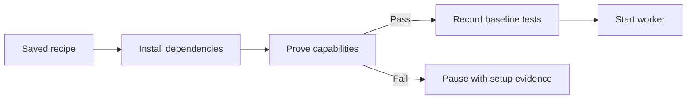

[Docs](README.md) / Understand the system

# Project preparation

Before a task starts editing, the controller prepares its Linux environment and records the starting test results. Codex and Muse use the same preparation path.



## Where the recipe comes from

The planner reads manifests and supplies setup commands, capability probes and baseline checks. A project can provide **`.sprowt/environment.json`** as its reusable default. The planner reads it; an explicit recipe in the accepted plan takes precedence, allowing a failed setup to be corrected during replanning. Older plans fall back to the file. Keep it in source control with placeholders instead of credentials.

Example for a Node project whose lockfile and test script already exist:

```json
{
  "inputs": ["package.json", "package-lock.json"],
  "system_packages": [],
  "setup": [{
    "name": "Install Node",
    "argv": ["/usr/local/bin/mise", "install", "node@22.16.0"],
    "timeout_seconds": 180
  }, {
    "name": "Install locked dependencies",
    "argv": ["/usr/local/bin/mise", "exec", "node@22.16.0", "--", "npm", "ci"],
    "timeout_seconds": 180
  }],
  "capabilities": [{
    "name": "Node runtime",
    "argv": ["/usr/local/bin/mise", "exec", "node@22.16.0", "--", "node", "--version"],
    "timeout_seconds": 30
  }],
  "baseline": [{
    "name": "Existing tests",
    "argv": ["/usr/local/bin/mise", "exec", "node@22.16.0", "--", "npm", "test"],
    "timeout_seconds": 180
  }]
}
```

Choose the runtime version supported by your project. Browser projects should add a real browser startup probe and required Debian libraries. Start any local server and its browser inside one probe so they share loopback access. See [browser checks](sandbox.md#browser-checks).

## What the results mean

| Phase | Failure behavior |
| --- | --- |
| System packages or setup | Pause before sending an editing turn |
| Capability probes | Pause and retain the failed command and output |
| Baseline tests | Save the failure and let the worker repair the starting source |
| Source changed during preparation | Preserve the edits and pause; fix the recipe |

**Task Details** shows saved preparation results. Press **e** to include passed commands. A setup failure offers **Revise repair plan**, carrying the recipe and evidence into planning. A revised plan can correct setup before the next worker starts. Keep the project file in sync with the corrected recipe for future plans. Network policy still applies; configure required download domains using the [network guide](sandbox.md#downloads).

Baseline results never satisfy completion checks, clear review findings or unlock publication. Final checks still run on the combined source.

## Reuse and limits

- Setup reuse is scoped to the task and keyed by recipe, declared input files, common manifests/lockfiles and the sandbox version.
- Reuse always reruns capability probes in the current VM and worker HOME. Failed probes rerun setup once, then probe again.
- Baselines rerun for each editing attempt. They are evidence of its starting source, not cached verification.
- Commands use absolute executables, project-relative file arguments and pinned runtime versions. Temporary task or worker paths are rejected.
- Recipes allow up to 32 input paths, 12 commands per phase and 1–180 seconds per command. At least one capability probe is required.
- System packages use the existing signed Debian installer. Shell commands retain normal worker permissions.
- Setup and baseline commands must leave source and lockfiles unchanged. Put generated dependencies and caches in their usual excluded locations.
- Private `environments/` receipts retain each attempt's commands, output, source fingerprint and error across restart. Retiring tasks does not reuse their preparation receipts for new task IDs.

Older plans without a recipe continue with worker-managed setup. They gain controller preparation when replanned or when the project supplies the recipe file. Reusing setup does not reproduce external package registries or guarantee identical VM images; pins, lockfiles and probes make changes visible.

**Next:** [Execution and final checks](execution.md) · [Troubleshooting](troubleshooting.md)
