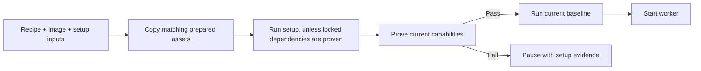

[Docs](README.md) / Understand the system

# Project preparation

Before a task starts editing, the controller prepares its Linux environment and records the starting test results. Codex and Muse use the same preparation path. Independent task setup, capability probes and baselines can overlap in fixed task sessions; package mutation and complete cache operations remain serialized.



## Where the recipe comes from

The planner reads project manifests and supplies setup commands, capability probes and baseline checks.

| Available recipe | Used by the controller |
| --- | --- |
| Explicit recipe in the accepted plan | The plan's recipe, including corrections made during replanning |
| No plan recipe, but `.sprowt/environment.json` exists | The project file |
| Neither | Worker-managed setup |

## Add a project recipe

This Node example needs a committed `package-lock.json` and an existing `npm test` script. Choose the pinned Node version supported by your project.

From the **project root**, create the configuration directory:

```sh
mkdir -p .sprowt
```

Save the following as **`.sprowt/environment.json`**:

```json
{
  "inputs": ["package.json", "package-lock.json"],
  "system_packages": [],
  "reusable_paths": [],
  "setup": [{
    "name": "Install Node",
    "argv": ["/usr/local/bin/mise", "install", "node@22.16.0"],
    "timeout_seconds": 180
  }, {
    "name": "Install locked dependencies",
    "argv": ["/usr/local/bin/mise", "exec", "node@22.16.0", "--", "npm", "ci"],
    "timeout_seconds": 180
  }],
  "capabilities": [{
    "name": "Node runtime",
    "argv": ["/usr/local/bin/mise", "exec", "node@22.16.0", "--", "node", "--version"],
    "timeout_seconds": 30
  }],
  "baseline": [{
    "name": "Existing tests",
    "argv": ["/usr/local/bin/mise", "exec", "node@22.16.0", "--", "npm", "test"],
    "timeout_seconds": 180
  }]
}
```

Check the file's JSON syntax on your Mac:

```sh
python3 -m json.tool .sprowt/environment.json > /dev/null
```

**Expected:** exit status 0 with no output. This checks JSON syntax only. The harness validates the recipe and runs its Linux commands when a task starts.

Commit the recipe with the project. Keep it free of credentials. If a revised plan corrects setup, update this file for future codemods too.

Browser projects also need a real browser startup probe and the required Debian libraries. Start the server and browser inside one probe. See [browser checks](sandbox.md#browser-checks).

### Recipe fields

| Field | Use | Limit |
| --- | --- | --- |
| `inputs` | Exact project-relative files that affect setup reuse | Up to 32 paths |
| `system_packages` | Required signed Debian package names | [Package policy](sandbox.md#system-packages) |
| `resources` | Optional explicit VM request, `{"memory_gib": 8}` | 8 GiB only; omit for ordinary allocation |
| `reusable_paths` | Optional locked dependency snapshot; defaults to `[]` | Only `["node_modules"]` |
| `setup` | Install the pinned runtime and locked dependencies | Up to 12 commands |
| `capabilities` | Prove the runtime or browser actually starts | 1–12 commands |
| `baseline` | Record tests before editing | Up to 12 commands |

Each command needs `name`, `argv` and `timeout_seconds`. Setup supports **1–600 seconds**. Capability probes and baselines support **1–180 seconds**. Begin `argv` with an absolute executable. Use project-relative file arguments; temporary task and worker paths are rejected.

For a large browser download, declare its budget explicitly in the recipe's `setup` array:

```json
{
  "name": "Install pinned Chromium",
  "argv": ["/usr/local/bin/mise", "exec", "node@22.16.0", "--", "npm", "exec", "--", "playwright", "install", "chromium"],
  "timeout_seconds": 600
}
```

Use the smallest measured budget that includes downloads and installation. **Pause** stops active setup; its saved result says preparation stopped. A longer setup budget does not extend baseline or completion checks.

Existing plans keep their declared budgets. To change an accepted plan's setup, request edits with the failed command and new budget. Updating the project file alone does not override the accepted plan.

Add `"resources": {"memory_gib": 8}` when your project explicitly needs that memory, for example for browser checks. The accepted plan recipe takes precedence over the source file. The harness does not infer memory needs from project type. Requests apply before source binding; an existing bound VM retains its allocation. See [resource admission and retained VMs](performance.md#vm-resource-budget).

## What the results mean

| Phase | Failure behavior |
| --- | --- |
| System packages or setup | Pause before sending an editing turn |
| Capability probes | Pause and retain the failed command and output |
| Baseline tests | Save the failure and let the worker repair the starting source |
| Source or lockfile changed during preparation | Preserve the edits, list changed paths and pause; choose **Revise setup recipe** |

Select **Implementation → 2 · Checks** to read saved setup failures before the task checks. **Inspect failure** opens the affected task. Press **e** for the complete preparation output, command, elapsed time and limit. The failure remains visible after restart. Preparation results never count as completion checks.

For commands that change source, choose **Ctrl+G → v · Revise setup recipe** from the workbench or task details. The correction includes the recipe, changed paths and evidence. Press **e** in task details for the complete path list and command output. An unchanged retry does not correct those commands. Transient download failures still offer retry; blocked downloads require [network approval](sandbox.md#downloads).

Preparation evidence also reports copied bytes, dependency reuse and cache rejection. Results belong to that attempt's source and worker HOME.

Baseline results never satisfy completion checks, clear review findings or unlock publication. Final checks still run on the combined source.

## Reuse across tasks

Each codemod VM holds an immutable cache of prepared assets. Tasks receive private copies, so changing one worker's installation cannot change another worker's files or the saved cache.

| Asset | Default behavior |
| --- | --- |
| Mise runtime installations | Copy verified files into a missing private installation directory |
| npm content downloads | Copy content blobs; omit index, configuration and authentication files |
| pip wheels | Copy wheel files; omit download-origin metadata and HTTP caches |
| `node_modules` | Copy only when explicitly declared reproducible; otherwise rerun setup |
| HOME, provider state, credentials, history, source and `.venv` | Never shared or cached as environment roots |

The key includes the **validated image digest and architecture**, recipe, declared setup inputs, common manifests/lockfiles and cache policy. Ordinary source edits leave this preparation key unchanged. A changed lockfile, image, recipe or declared input starts fresh preparation.

Runtime and download reuse still runs setup in every new task. Setup can reuse local downloads. The cache never overwrites an existing destination.

### Opt in to locked Node dependencies

For a deterministic `npm ci` project, change the recipe field to:

```json
"reusable_paths": ["node_modules"]
```

**Prerequisites:** declare both `package.json` and `package-lock.json` in `inputs`, pin Node, and include every additional setup input. For example, declare `scripts/install.js` when an install script reads it. Do not opt in when installation embeds a task path, consumes undeclared source files or depends on secrets or mutable external state.

**Expected:** the first successful setup saves a verified snapshot. A matching new task can skip setup only after the complete snapshot is copied and its capability probes pass. An absent snapshot, existing dependency directory, changed input or failed probe runs setup again. Private configuration or history inside `node_modules` rejects the snapshot, rather than silently omitting required files.

- Every reuse reruns capability probes in the current VM and worker HOME. Failed probes trigger one setup retry.
- Repeating an attempt can retain preparation only in the same worker HOME with the same key and no saved preparation error.
- Baselines run on every editing attempt against current source. Final checks remain separate.

### Cache failure and limits

Missing, corrupt or unsupported assets fall back to fresh setup. An interrupted operation stops the attempt. Copies check content, file modes and relative links; absolute links, escaping link chains, hard links and special files are rejected.

The cache retains up to **3 environments per codemod**, each at most **512 MiB / 100,000 entries**. Publication is serialized; restores create protected staged copies, then move them into private paths. A copy or publication has a 90-second budget. The next operation removes interrupted staging copies while preserving active copies and worker source. These limits may prevent reuse for large dependency trees; they do not prevent normal setup.

Setup and baseline commands must leave source and lockfiles unchanged. Put generated dependencies and caches in their usual excluded locations. Commands retain normal worker permissions.

Updates to `.pytest_cache`, `.mypy_cache` and `.ruff_cache` are generated test output. They do not count as source edits. If those caches were already tracked, Sprowt preserves their starting contents in checkpoints and PRs while tests can update their runtime copies. Tracked distribution assets, database fixtures, source and lockfiles remain protected.

Private `environments/` receipts preserve commands, output, source fingerprints, worker HOME, cache decisions and errors across restart. Each attempt has its own file, including stopped or superseded attempts. The latest pointer updates only for the current task owner, attempt and VM identity. Receipt files use mode `0600`. New task IDs get their own preparation records. The cache stays inside the codemod VM; deleting that VM also removes its prepared assets.

Older plans without a recipe continue with worker-managed setup. They gain controller preparation when replanned or when the project supplies the recipe file. Existing recipes without `reusable_paths` retain the default `[]`. Reuse does not reproduce external package registries; declared inputs, immutable assets and current probes bound what is reused.

**Next:** [Execution and final checks](execution.md) · [Troubleshooting](troubleshooting.md)
