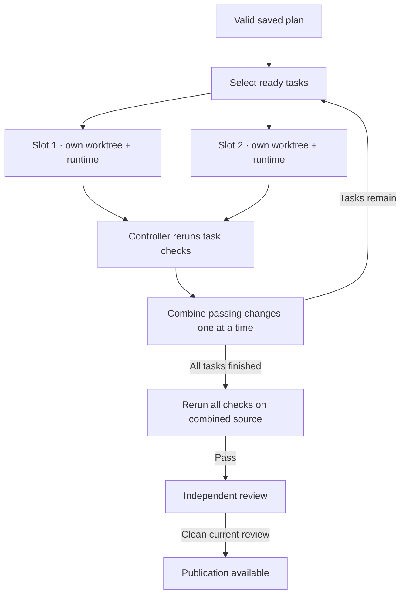
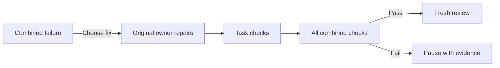

[Docs](README.md) / Understand the system

# Execution and checks

The scheduler runs ready tasks in isolated worktrees, combines verified changes, then checks and reviews the complete version.

[Task lifecycle](#tasks-and-checks) · [Check contract](#write-repeatable-checks) · [Recovery budgets](#recovery-budgets) · [Source filtering](#source-and-generated-files)

## Tasks and checks

1. **Reserve a ready task.** Dependencies must be complete. The provider and owner save before delivery.
2. **Prepare its worktree.** The task starts from the latest combined source at `/tasks/<task-run-id>`.
3. **Implement and check.** The worker installs compatible dependencies and calls `run_task_checks` before returning its report.
4. **Verify independently.** Rust reruns the report's commands and rejects missing checks, changed source or failures.
5. **Integrate.** Passing task changes merge one at a time into `/workspace`.
6. **Verify together.** Task worktrees refresh to the combined source and rerun every check with their retained dependencies.
7. **Review.** Combined success starts a fresh [independent review](review.md).

Each codemod has two active slots: two Codex workers, two Muse workers or one of each. Connecting and verification occupy slots. Idle workers are parked and reused. Review repairs run one owner at a time.

A single controller serializes VM setup, checkpoints, integration, checks and system package installation. Independent model turns and ordinary commands can overlap. Workers with unanswered [peer questions](coordination.md) wait; unrelated work can continue.

## Working folder

| Location | Purpose | Writable by |
| --- | --- | --- |
| Host codemod worktree | Committed starting point and Git publication | Harness Git adapter |
| VM `/workspace` | Combined source and local integration branch | Controller |
| VM `/tasks/<task-run-id>` | A task branch and its project dependencies | Assigned worker and controller |
| VM `/home/sprowt/workers/<worker-id>` | Runtime installations and download caches | Assigned worker |
| Host workspace `work/` | Source exported for planning and checkpoints | Harness |

The original repository metadata, remotes and credentials stay on the Mac. The VM has a separate local Git repository; host folders are not mounted there.

A retry retains its worker, task folder and scope. Task folders stay through combined verification, review and repairs. A replacement plan removes retired task folders and their local dependencies; per-worker runtimes and download caches remain in the VM. Closing deletes the VM. See [retention](local-state.md#what-survives).

## Write repeatable checks

A completion check names a required outcome. It can contain several commands, each using the **exact declared check name**.

| Rule | Reason |
| --- | --- |
| Use an absolute executable path | The check starts with a fresh process environment |
| Resolve project files from the task working directory | The source can be refreshed or restored |
| Start and stop required services inside the command | Earlier background processes are not check setup |
| Put temporary fixtures under `/tmp` or HOME | Browser URL paths such as `/static` are not writable fixture directories |
| Keep source unchanged during checks | Results must describe one source version |
| Return every declared check | Missing or undeclared checks block completion |
| Preserve requirements when fixing a test | Removing assertions is not a repair |

The [tool reference](tools.md#run-task-checks-example) includes a complete `run_task_checks` payload. The controller reruns submitted commands before accepting source; the tool itself does not finish or merge a task.

### Time budgets

Commands default to **30 seconds**. Set `timeout_seconds` to **1–180**, or `null` for the default. Include measured startup, execution and cleanup time. Inner test and wrapper deadlines must fit within the outer budget.

Diagnose a hanging operation before raising its limit. For browser checks, register the response wait before triggering the action, wait for the matching successful response and resulting UI state, and control request completion when testing races.

Results save elapsed time, the limit, exit code and output. Missing executables are recorded separately. A failed or interrupted combined pass stops; skipped commands remain **not run**. Polling or reopening cannot restart that pass.

### Repeated commands

Identical argument arrays with the same budget run once within a single task verification pass. Their observed result can cover multiple named checks. Reuse never crosses task folders, worker homes, retries or verification passes.

### Saved check scripts

Standalone scripts can be included in `run_task_checks`. They live outside project source at `/opt/sprowt-checks/<task-run-id>/` and are restored from a private host copy before checks.

| Field or limit | Behavior |
| --- | --- |
| `scripts: null` | Retain the saved bundle |
| `scripts: [...]` | Replace the bundle |
| Up to 16 scripts / 256 KiB total | Plain filenames and text contents |
| Up to 32 check entries per call | Must cover all declared checks |
| Source and script fingerprints | Tie results to the tested contents |

Guest scripts are read-only. Use an absolute interpreter and script path, read project files from the task working directory, and write fixtures elsewhere.

Scripts survive retries, review and restart, including VM recreation. Runtimes still need installation in a fresh VM. A replacement plan removes retired bundles. Older checks referencing `/tmp` scripts need those scripts resubmitted as saved bundles.

### Reports and later messages

A late peer acknowledgement with no commands retains the last valid report. A newer full report, blocker or repair request replaces it. User steering clears the previous report and requires a fresh one. Recovered history follows the same rules; retained commands still run against current source.

## Fix a failed combined check

**Ctrl+T → 2 · Checks → x** or **Ctrl+G → x** chooses **Fix failed check**, when the failure has a recorded owner and command.

The original worker receives the latest combined source, scripts, command and failure output. It can repair source within its scope or correct a faulty check while preserving coverage. Completed peers keep their work and owners.

The requested attempt pauses if it fails; it does not reset the automatic recovery budget. **Retry final checks** in More reruns saved commands without asking a worker to change them. It is also the fallback when no owner matches the failure.

## Recovery budgets

These are separate limits, saved across restart and explicit retry. A new plan starts new budgets; previous evidence remains history.

| Recovery | Automatic allowance | When it stops |
| --- | --- | --- |
| Failed task verification | One feedback attempt for that task | A repeat failure; stops, timeouts and mismatched reports do not trigger feedback |
| Missing check executable | Shares that task's one feedback attempt | Dependencies still unavailable or recovery fails |
| Task merge conflict | One resolution attempt per task and plan | Repeated, non-text or out-of-scope conflict |
| Integration repair handoff | Two handoffs per plan | Persistent failure offers **Revise repair plan** |
| Review repair | Two authorized passes per plan | No progress, uncertain evidence or remaining issues after the limit |

### Verification feedback

A failed controller task check returns the command and output to its original owner. The worker keeps its folder and scope, preserves coverage and reruns all checks, including previously skipped ones. Repeated failure pauses that task and its dependents; independent peers can finish.

### Missing task environments

Before a check runs, the controller verifies its executable exists. A missing executable during final verification can return to the owner for bounded dependency recovery. The owner receives current source and commands; no project language is hard-coded. Success still requires task and combined checks. Reinstalling the harness alone does not resume paused work.

### Task conflict recovery

Integration saves both versions, paths, non-conflicting changes and text markers with their common base when available. The owner can resolve a text conflict once within its original scope, preserving both tasks' behavior.

Binary, rename, deletion and out-of-scope conflicts pause. Product decisions become questions. Unresolved markers block integration even if a command passes; failed checks during resolution pause rather than start another automatic recovery.

Task Details shows paths, owners and attempts. Explicit retry retains the counter. Older paused runs stay paused until retried.

### Automatic repairs

An integration worker can return a repair request for a completed peer's defect. It must provide:

- The owner task and exact affected files.
- A declared failing check belonging to the reporting task.
- An absolute runnable command and short observed failure evidence.

Rust validates the request and waits for active turns and checks to finish. The owner repairs current combined source; the verifier's unfinished changes are preserved and merged back. Affected dependent tasks and all combined checks run again. Unrelated completed tasks stay done.

Repair requests cannot expand ownership or approve access. Invalid fields, missing access, uncertainty and product decisions pause. Two unsuccessful handoffs offer **Revise repair plan** with saved evidence; blind retries cannot restart an exhausted repair.

For finding IDs, closure and automatic continuation after review, see [Review and repairs](review.md).

## Source and generated files

| Files | Checkpoint behavior |
| --- | --- |
| Code, regular file modes and deletions | Preserved |
| Tracked distribution files and database fixtures from the starting source | Edits and deletions remain source changes |
| New `dist/`, test caches, `.egg-info`, runtime databases and sidecars | Stay on the VM disk, outside PR diffs |
| Already committed `.egg-info` | Retains baseline contents despite regeneration |
| Credentials, dependency folders and caches | Excluded; `.env.example` and `.env.sample` are included |

Filtering includes nested build output, common Python caches, DuckDB, SQLite and `.db` files with WAL, shared-memory and journal sidecars. Source remains visible even if a generated `.gitignore` would hide it.

Private save copies preserve the checked files and permissions. Changed source or outside worktree edits pause saves. Reconnection repairs older checkpoint indexes and drafts containing generated-only conflicts without deleting runtime data; committed source conflicts still need resolution.

## Edits, target updates and pauses

Queued edits start a new plan against saved source after the current version is verified. Sending edits after failure can replan unfinished work. Steering reaches active workers separately. See [messages](codemods.md).

Target updates reuse the VM, preserve worker runtimes and replace task folders with an integration plan carrying the original checks. Publication still requires fresh checks and review. See [Git updates](git-workflow.md#when-another-codemod-merges).

**Ctrl+R** pauses or resumes eligible work. **Details → Tasks → r** targets a failed task while peers continue. Reopening never automatically resumes unfinished execution. See [local state](local-state.md) for what survives exit, close and deletion.

**Next:** [Worker connections](workers.md) · [Tool payloads](tools.md) · [Live verification](development.md#live-checks)
