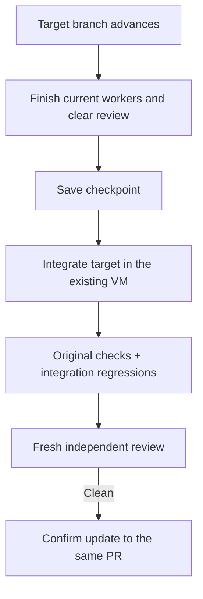
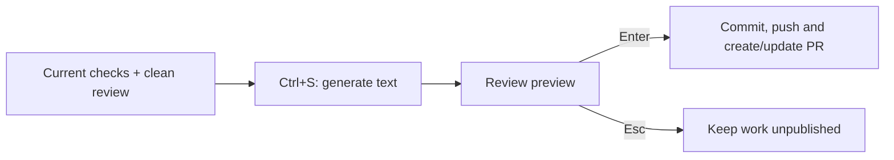
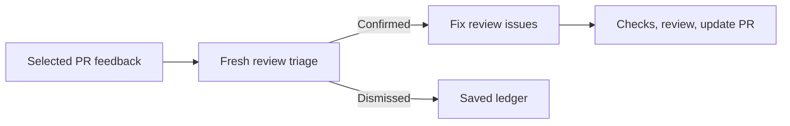

[Docs](README.md) / Use the harness

# Git workflow

Each codemod owns a branch and worktree. Workers build in Linux; Git credentials and publication stay on your Mac. You confirm every PR publication or update.

[Starting files](#start-in-any-folder) · [Sync](#keep-the-project-current) · [Target updates](#when-another-codemod-merges) · [Publish](#publish-a-pr) · [PR feedback](#read-and-fix-pr-feedback) · [Close and reopen](#close-reopen-or-delete)

## Start in any folder

| Folder | Starting point |
| --- | --- |
| Empty, without Git | Confirm an empty initial commit |
| Existing files, without Git | Review files and confirm the initial commit |
| Git, without commits | Review and commit the starting files |
| Git, with commits | Check remote, safely fast-forward, then use committed `HEAD` |

Initial setup respects `.gitignore` and excludes common credentials, dependencies and caches. It preserves source bytes and executable permissions. **Enter** confirms; **Esc** returns to the description. Changed files block the reviewed setup. New repositories use `main`; an existing unborn branch keeps its name.

Uncommitted edits remain in your project and are not included in a new codemod. Commit required starting changes first.

## Keep the project current

The harness checks the checked-out branch on startup and every **30 seconds**, including with no codemods open. **Ctrl+U** checks immediately. Closing the harness stops checks until you reopen it.

| Condition | Behavior |
| --- | --- |
| Configured upstream | Fetch and safely fast-forward from it |
| No configured upstream, matching branch on `origin` | Use that branch |
| Already current or locally ahead | Keep committed source |
| Detached commit, local-only branch or no remote | Keep the local starting point |
| Missing configured upstream | Show an error |
| Overlapping edits, divergence or active Git operation | Preserve files and pause sync |

Updates never switch branches, rebase, create a merge commit or push the project branch. Local edits and staging stay. Previously untracked files incorporated by a merged PR become tracked against the merge; differing local bytes remain edits.

Creating a codemod also checks before making its worktree. A failed setup cannot start its planner with stale source. **Ctrl+R** retries setup; an untouched worktree can refresh before another planning attempt.

### Sync warnings

Background failures show **Sync needs attention** separately from local work. Open **Ctrl+G → s · Sync details** to distinguish the project branch from a codemod target. **Ctrl+U** retries the failed check; its warning clears only when that check succeeds.

Retrying a sync warning does not invalidate the current review or start a source update. Foreground setup, publication and integration failures keep their own recovery actions.

### Codemod operation failures

Git failures stay with the codemod and operation that failed. Switch codemods with **Ctrl+P** to inspect another codemod's error; returning keeps its error and draft. A successful operation clears its own error. Other failures remain, with the latest shown in the dock.

| Failed operation | Recovery |
| --- | --- |
| Commit and PR text | **Ctrl+S** generates a new preview |
| Setup, publication or saved merge | **Ctrl+R** retries from saved work |
| Project or target sync | **Ctrl+G → s · Sync details**, then **Ctrl+U** |

## When another codemod merges

Build codemods concurrently and merge PRs one at a time on GitHub. The harness checks each PR target every 30 seconds.



An open PR becomes a draft when a newer target is detected. Current workers finish before source changes. Finished versions update automatically after a clean review; open findings, repairs and unfinished review hold the update. Paused or failed work waits for retry or edits.

With no sync warning, **Ctrl+U** from the conversation can explicitly update a finished version. That invalidates its previous review.

The integration plan carries original checks and adds regressions for the combined behavior. A worker receives both goals, upstream commit messages and conflicting versions. Text conflicts resolve in the existing VM; conflicting product intent becomes a question. Clean merges receive the same verification.

Passing checks save a merge commit with both parents. Drafts, queue and history stay. Worker runtimes remain; old task folders are replaced. Publication requires a clean current review and fetches the target again, so another target change can require another update.

### Interrupted or unsafe updates

Checkpoints preserve both commits and saved source. If saving fails after verification, retry can finish the save without repeating workers while source remains unchanged. Changed source needs new checks.

Binary conflicts, rewritten target history, protected-file changes and outside worktree edits pause for reconciliation. Each codemod fetches into its own `refs/sprowt/upstream/<branch>`; these checks do not update remote-tracking references or `FETCH_HEAD`.

The harness does not merge PRs or enforce merge order. Use GitHub branch protection or a merge queue when current checks must be required at merge time.

## Publish a PR

First complete the [GitHub login setup](quickstart.md#6-publish-the-pr).

1. Wait for passing combined checks and a clean review of the **current source**.
2. Inspect the diff with **Ctrl+D**.
3. Press **Ctrl+S**, or **p** from the diff.
4. Wait for the commit and PR text, then review the titles, summary and verification. **Enter** publishes; **Esc** cancels.



Without an origin, choose **connect existing** or **create private** with Tab, enter `owner/repository`, then confirm. An empty repository receives the starting commit. A populated repository must share history and contain the target branch; unrelated history is never overwritten.

| Publication detail | Value |
| --- | --- |
| Target | Starting branch; GitHub default branch if starting detached |
| Codemod branch | `sprowt/mod-<id>-<stamp>` |
| After publication | VM, worktree and conversation remain available |
| Further edits | New plan, fresh checks/review, then update the same open PR |
| PR merged or closed | Start a new codemod |

Outside changes to the PR branch or worktree block publication and preserve local work. The PR URL and commit save before success is shown.

### Commit and PR text

A short Codex call using **Sol 6.1, low effort** writes the commit title, PR title and summary. It reads the reviewed diff, the request and recent commit subjects. Follow-up commit titles describe changes since the last published version; PR text describes the whole change.

Titles are limited to **72 characters**. The summary is one paragraph or up to three bullets, at most **100 words**. The controller adds recorded check counts and review status. The writer is instructed to avoid hype, agent attribution and claims about tests or performance.

Example titles and summary, shown as a simplified illustration:

```text
Commit  Preserve task IDs when retrying a saved operation
PR      Preserve task IDs when retrying a saved operation

Restore saved operation receipts before accepting retries so a
reconnected client receives the original task instead of a duplicate.
```

The controller adds actual verification results below the generated summary. If the project has a PR template — `.github/pull_request_template.md`, `docs/pull_request_template.md` or `pull_request_template.md`, plus the uppercase spellings — the posted body keeps it **verbatim** between the summary and the verification results, checklists and HTML guidance included. The publication preview shows that exact body. Complete the checklist on GitHub after publishing. Editing the template makes a saved preview outdated, like any source change. A template over 30,000 characters stops preview with an error instead of being truncated.

| Situation | What happens |
| --- | --- |
| Retry with unchanged source, base, published head, request and verification | Reuse the validated text |
| Any of that context changes | Generate a new preview |
| Generation fails or exceeds two minutes | Keep work saved; **Ctrl+S** retries |
| Update an existing PR | Replace its title and description with the previewed text, including manual edits to those fields |

There is no fallback that copies your request into a commit message. Published commit messages are not rewritten; publication never force-pushes.

<details>
<summary>Writer isolation and Git history</summary>

The writer uses a separate temporary directory with read-only permissions, shell tools disabled and no inherited rules, user configuration, plugins or connectors. It uses your existing Codex login. Large diffs use marked excerpts from each file. Temporary input and provider output are removed after generation; the validated draft stays in private local state.

Publication combines unpublished checkpoints into one commit. Later publications append to the last published commit and retain upstream merge ancestry. Private checkpoint references keep recovery history.

</details>

This design draws on [GitHub Copilot's diff-based commit suggestions](https://docs.github.com/en/copilot/responsible-use/chat) and [Devin's concise default PR summary](https://docs.devin.ai/integrations/pr-templates). Choosing between multiple templates in a `PULL_REQUEST_TEMPLATE` directory and custom publication instructions are not yet supported.

## Read and fix PR feedback

While the harness is open, each target check also reads the open PR on your Mac, at most every 30 seconds. Reading sends nothing back to GitHub.

1. Open the published codemod.
2. Select **Pull request** in the terminal, or the **Findings** tab in the macOS app's side pane.
3. Select the items to act on: **Ctrl+G → Fix PR feedback**, then **Space** to mark and **x** to send in the terminal; use the checkboxes and **Send selected to review** in the app.
4. A fresh review triages each selected item. Confirmed defects then appear under **Fix review issues**; dismissals stay in the [finding ledger](review.md#understand-a-finding). Repairs run fresh checks and review, then update the same PR.



**Expected:** unresolved review threads, reviews, PR comments and checks that failed on the published commit are listed with their author or check name and a link. The dock counts unresolved threads, change requests, review comments and failed checks that are not yet in review. Resolved threads, dismissed reviews and passing or still-running checks are omitted. Approvals and plain PR comments are listed but not counted.

Sending feedback requires a clean review of the current source, so the published version is the usual starting point. External feedback is untrusted: it enters the ledger as **investigate**, never as a confirmed defect, and no worker repairs it until the fresh reviewer confirms it with an owner, acceptance criterion and regression. Items already in the ledger — including ones a reviewer dismissed — are marked **in review** and are not imported again. Reading feedback never blocks publication or sync, replies to or resolves threads, or merges the PR. If GitHub cannot be read, the stage shows **GitHub feedback unavailable** with the error and target sync continues. Each read covers the newest 50 threads, reviews and comments, and the checks on the published commit.

## Close, reopen or delete

Open **Ctrl+P**. Use **Tab** to switch active and closed lists.

| Action | What stays | What is removed |
| --- | --- | --- |
| `c` · Close, then confirm | Source checkpoint, branch, worktree, history, draft and queue | VM and runtime |
| `r` · Reopen closed work | Saved source and history; execution waits for resume | Nothing |
| Enter on closed work | Read-only history view | Nothing |
| `d` · Delete, then confirm | Existing PR on GitHub | Local codemod records, worktree and VM |

Closing stops workers, exports source and task branches, then commits a local checkpoint before VM deletion. It works without GitHub and preserves unfinished work. Reopening creates a fresh VM only when execution resumes.

Closed worktrees are pruned after **30 days**, checked at project startup. `--closed-worktree-days N` changes retention; **0** disables pruning. Only unchanged checkpoint worktrees are removed. Branches, history and exports remain, allowing restoration on reopen. Outside edits skip pruning.

## Saved snapshots and recovery

Older snapshot codemods offer Git adoption before publication or closing. Confirm the saved starting files as the baseline. Adoption preserves source, checks and conversation; an existing repository must match that baseline. Publication still requires current checks and review.

Interrupted repository setup retains its request. **Ctrl+R** retries; **Ctrl+D → p** can change the destination. Failed publication, checkpoint saves and VM deletion retain recovery metadata. Existing remotes and unrelated history remain intact.

## Current limits

GitHub is supported; GitHub Enterprise and other hosts are not. Symlinks and submodules are unsupported. Run one harness instance per project.

**Next:** [Local retention and recovery files](local-state.md) · [GitHub troubleshooting](troubleshooting.md#github-and-sync-errors)
