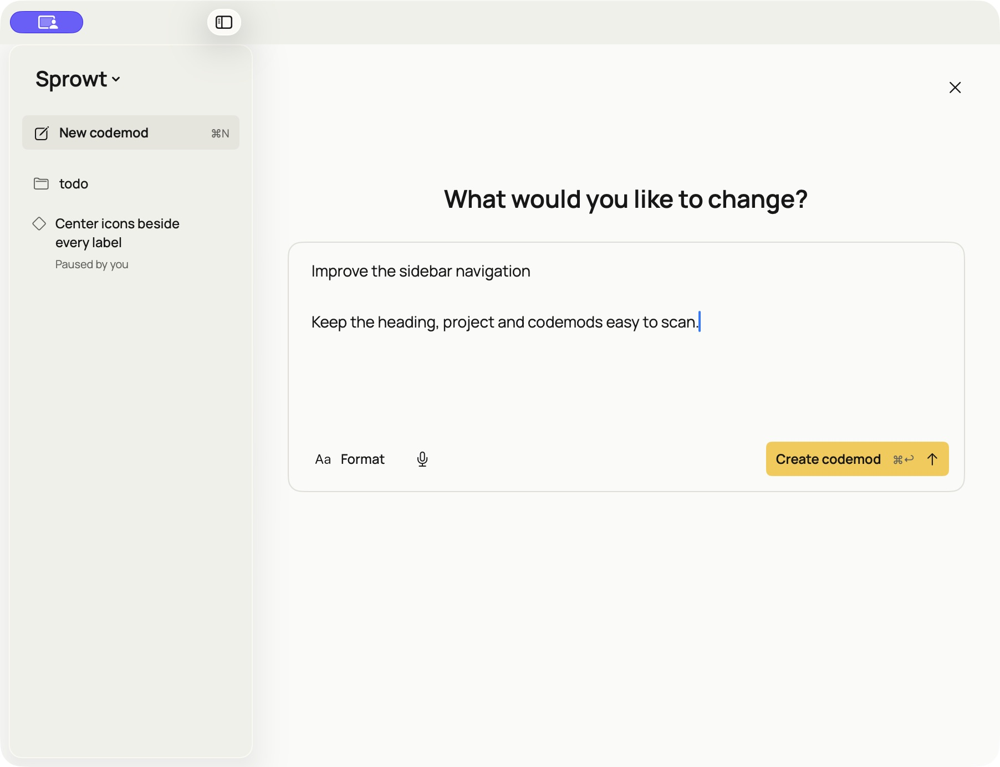
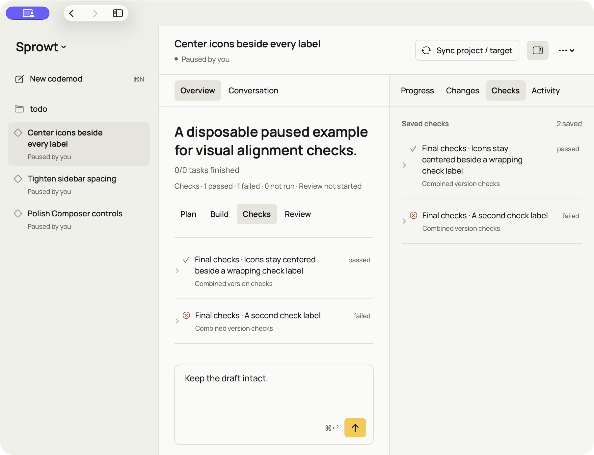

[Docs](README.md) / Use the macOS app

# Run Sprowt on macOS

Use the native SwiftUI interface with the same Rust engine and saved work as the terminal app.

## Build and open

Install Xcode 26 or newer and Rust, then complete the [worker setup](quickstart.md#1-prepare-the-workers). The app uses the same supported Codex login, optional Muse account and Apple Container service as the CLI.

From the harness repository:

```sh
./macos/build.sh
open target/macos/Sprowt.app
```

**Expected:** Sprowt opens a native window with its yellow seedling icon. Choose a project folder to load its codemods. The build includes the Rust executable inside the app, so the interface and engine come from the same checkout.

The matching terminal executable is `target/release/sprowt-harness`. To update a separately installed CLI, run `cargo install --path . --locked --force` from this checkout as well.

The bundle is signed locally for development. It is not a notarized distribution release.

## Work on a project

Choose a codemod in the sidebar to open its workspace. The feed shows the plan outcome, its numbered task checklist with outcomes and dependencies, then the conversation with messages and questions that need your answer.

Select a task or a connected worker to read its current attempt, latest update and check output in the side pane. The **Changes**, **Checks**, **Findings** and **Activity** tabs switch the side pane's evidence; it is the one place for diffs, check output, review findings and the work log. Hide the pane when you want more room.

In **Changes**, choose the offered inspection action to read the actual diff. Inspections are ordinary side-pane content: keep typing, switch tabs or codemods, and choose **Done** whenever you finish reading. Only starting a new codemod asks you to finish an inspection first, since it replaces the workspace. Opening evidence never starts a worker.

The header button shows Rust's recommended action; **More** holds the other available actions. A partial review with confirmed findings offers **Fix review issues**, while publication waits for a complete, clean review. See [review and repairs](review.md).

Choose **New codemod** or press **⌘N** to describe the change in the compact creation editor. **Create codemod** or **⌘Return** starts the same planning and execution flow as the terminal app. The planner supplies a short title while the complete request stays in the conversation. Setup, network access, publication, closing and deletion retain their explicit confirmation steps.



Actual native creation editor using a disposable project. No plan was created.

The creation editor shows headings, emphasis, lists, checklists and code as formatted text. Choose **Format**, or type `/` at the start of an empty line, to select a format. Use **↑**, **↓** and **Return**, or click a choice. **Esc** closes the menu and preserves its slash; continuing a path such as `/Users/...` closes the menu and preserves the path. **⌘B**, **⌘I** and **⌘E** toggle bold, italic and inline code. **⌘Z** and **⇧⌘Z** undo and redo edits.

**Dictate** starts macOS Dictation at the editor's caret. Enable it in **System Settings → Keyboard → Dictation** if needed. You can also choose **Edit → Start Dictation**. System controls show dictation feedback. Dictation only inserts text; choose **Create codemod** or **⌘Return** explicitly when the request is ready.

The editor sends Markdown through the existing Rust command. Supported formatting appears in the app; unsupported Markdown remains literal, with its source preserved. Code blocks contain literal text, so inline emphasis does not apply inside them. The full request is stored in both interfaces.

The **Sprowt** menu at the top of the sidebar contains **Open project…** and the switch between active and closed codemods. **⌘O** opens a project folder directly. Each codemod has a diamond glyph, status and agent count when workers exist.

Use the title bar's sidebar button or the sidebar command in **View** to hide or show the sidebar. **⌃⌘S** works while the sidebar is hidden. Your codemod selection and composer drafts stay in place.

Use the title bar's **Back** and **Forward** arrows, **View → Back / Forward**, or **⌘[** and **⌘]** to revisit codemods and unfinished creation. [Navigation history](codemods.md#create-and-manage-work) lasts for the current project session. Inspections do not block navigation; confirmations still do.

Press **⌘1**–**⌘4** to open the **Changes**, **Checks**, **Findings** and **Activity** side-pane tabs. The app follows your system appearance and text size in both light and dark mode, and status is always shown as text as well as color — blue while work runs, gold when Sprowt needs you, green when ready or published.

Use the composer to answer a question or queue an instruction. Expand the attached queue to edit, reorder, remove or steer pending instructions. Save an edit before choosing **Steer**. These actions preserve the composer draft. Removing the last queued instruction closes the queue and returns focus to the composer. Steering without connected workers saves instructions as waiting for workers; it does not claim delivery.

The app is a macOS interface; workers still build and check source in Linux. See [execution boundaries](architecture.md#boundaries-today).

## Find the same work in the terminal

Both interfaces use the same plans, task inspection, check results and action rules. Their layouts and shortcuts fit their host interface.

| In the macOS app | In the terminal |
| --- | --- |
| Feed and task checklist | Stage rail in the [Evidence Workbench](terminal.md#read-the-screen) |
| Task or worker inspection | Select a task and press Enter, or open **Ctrl+T · Details** |
| Changes, Checks, Findings and Activity pane | **1–4** in the workbench; full results in Details |
| Attached queue | **Ctrl+Q · Queue** |
| Contextual actions | Action dock or **Ctrl+G · More** |
| Back / Forward or **⌘[ / ⌘]** | Header arrows or **Alt+← / Alt+→** |
| Creation editor's Format menu | **F2 · Format** in the new codemod composer |
| Dictate | Host terminal's dictation or paste, when supported |

## Switch between interfaces

Close the current interface before opening the same project in the other. Both use the [same local state](local-state.md). A project lock prevents two controllers from running its workers at once.

Saved plans, messages, drafts and results remain available. Reopening unfinished work does not resume workers automatically; choose the offered resume action.

Live simultaneous control from both interfaces is not implemented. The shared Rust engine keeps workflow behavior in one place, while terminal and SwiftUI presentation remain separate.

## Develop the interface

Run the native tests from the harness repository:

```sh
swift test --package-path macos
```

The native app communicates with its bundled engine over local stdin/stdout. Typed commands carry a request ID; responses contain the protocol version, an acknowledgement or error, and the current snapshot. The snapshot includes the navigation destination and available directions. Swift owns rendering and editing focus. Rust owns navigation history, scheduling, permissions, persistence and workflow transitions.

The light theme uses Minimum Effort's Manrope font, warm neutral backgrounds and yellow action accents. Manrope is bundled under the SIL Open Font License; the app does not fetch fonts at runtime. Its [source](../macos/Sources/SprowtDesktop/Resources/Manrope/SOURCE.txt) and [license](../macos/Sources/SprowtDesktop/Resources/Manrope/OFL.txt) are included with the bundle.

Row icons align with the center of their label's first line, even when the label wraps.



Example paused codemod with sample saved checks in a disposable project.

For an isolated development session, replace both paths below with disposable directories:

```sh
open -n target/macos/Sprowt.app --args \
  --project /path/to/test-project \
  --data-dir /path/to/test-state
```

An alternate data directory separates harness records; it does not make project operations read-only or replace worker credentials. Use a disposable project when testing actions.

**Next:** [Codemods and messages](codemods.md) · [Development checks](development.md)
