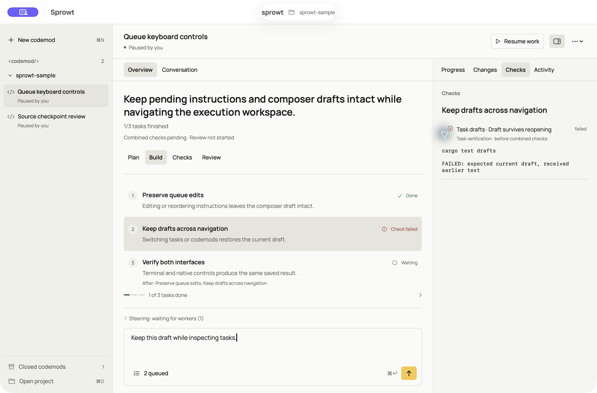

[Docs](README.md) / Use the macOS app

# Run Sprowt on macOS

Use the native SwiftUI interface with the same Rust engine and saved work as the terminal app.

## Build and open

Install Xcode 26 or newer and Rust, then complete the [worker setup](quickstart.md#1-prepare-the-workers). The app uses the same supported Codex login, optional Muse account and Apple Container service as the CLI.

From the harness repository:

```sh
./macos/build.sh
open target/macos/Sprowt.app
```

**Expected:** Sprowt opens a native window. Choose a project folder to load its codemods. The build includes the Rust executable inside the app, so the interface and engine come from the same checkout.

The matching terminal executable is `target/release/sprowt-harness`. To update a separately installed CLI, run `cargo install --path . --locked --force` from this checkout as well.

The bundle is signed locally for development. It is not a notarized distribution release.

## Work on a project

Choose a codemod in the sidebar to open its execution workspace. **Overview** shows the plan's numbered tasks, outcomes and dependencies. **Conversation** shows messages and questions that need your answer.



*Native app with saved sample tasks and results. No workers are running in this example.*

Use **Plan**, **Build**, **Checks** and **Review** to inspect the saved work. Select a task or a connected worker to read its current attempt, latest update and check output beside the main view. The **Progress**, **Changes**, **Checks** and **Activity** tabs switch the side pane's evidence. Hide the pane when you want more room.

In **Changes**, choose the offered inspection action to read the actual diff. Choose **Done** to finish an inspection before sending instructions or changing codemods. Opening evidence never starts a worker.

The available actions come from Rust and change with the current workflow state. Starting a new codemod starts the same planning and execution flow as the terminal app. Setup, network access, publication, closing and deletion retain their explicit confirmation steps.

Use the composer to answer a question or queue an instruction. Expand the attached queue to edit, reorder, remove or steer pending instructions. Save an edit before choosing **Steer**. These actions preserve the composer draft. Removing the last queued instruction closes the queue and returns focus to the composer. Steering without connected workers saves instructions as waiting for workers; it does not claim delivery.

The app is a macOS interface; workers still build and check source in Linux. See [execution boundaries](architecture.md#boundaries-today).

## Find the same work in the terminal

Both interfaces use the same plans, task inspection, check results and action rules. Their layouts and shortcuts fit their host interface.

| In the macOS app | In the terminal |
| --- | --- |
| Overview and stage navigation | Stage rail in the [Evidence Workbench](terminal.md#read-the-screen) |
| Task or worker inspection | Select a task and press Enter, or open **Ctrl+T · Details** |
| Checks, Changes and Activity panes | **1–4** in the workbench; full results in Details |
| Attached queue | **Ctrl+Q · Queue** |
| Contextual actions | Action dock or **Ctrl+G · More** |

## Switch between interfaces

Close the current interface before opening the same project in the other. Both use the [same local state](local-state.md). A project lock prevents two controllers from running its workers at once.

Saved plans, messages, drafts and results remain available. Reopening unfinished work does not resume workers automatically; choose the offered resume action.

Live simultaneous control from both interfaces is not implemented. The shared Rust engine keeps workflow behavior in one place, while terminal and SwiftUI presentation remain separate.

## Develop the interface

Run the native tests from the harness repository:

```sh
swift test --package-path macos
```

The native app communicates with its bundled engine over local stdin/stdout. Typed commands carry a request ID; responses contain the protocol version, an acknowledgement or error, and the current snapshot. Swift owns rendering and editing focus. Rust owns scheduling, permissions, persistence and workflow transitions.

The light theme uses Minimum Effort's Manrope font, warm neutral backgrounds and yellow action accents. Manrope is bundled under the SIL Open Font License; the app does not fetch fonts at runtime. Its [source](../macos/Sources/SprowtDesktop/Resources/Manrope/SOURCE.txt) and [license](../macos/Sources/SprowtDesktop/Resources/Manrope/OFL.txt) are included with the bundle.

For an isolated development session, replace both paths below with disposable directories:

```sh
open -n target/macos/Sprowt.app --args \
  --project /path/to/test-project \
  --data-dir /path/to/test-state
```

An alternate data directory separates harness records; it does not make project operations read-only or replace worker credentials. Use a disposable project when testing actions.

**Next:** [Codemods and messages](codemods.md) · [Development checks](development.md)
