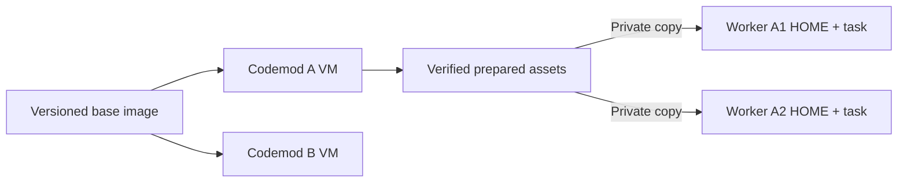
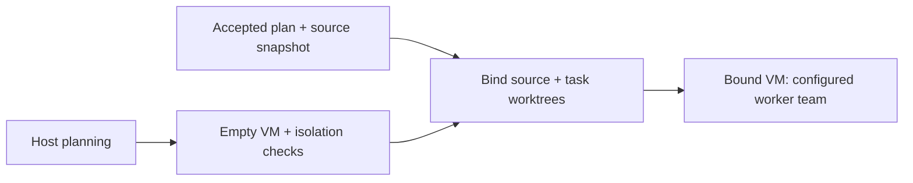
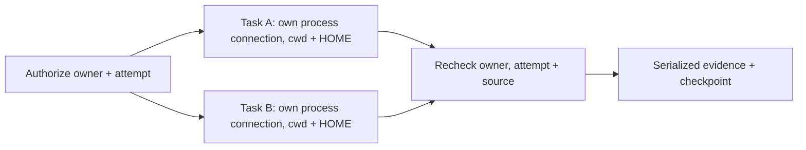

[Docs](README.md) / Understand the system

# Worker startup and timings

The harness reuses verified setup while keeping each codemod's source and runtime homes separate.

## Read startup timings

1. Open the codemod's workspace.
2. Choose **5 · Agents** in the terminal, or **Agents** in the app.
3. Press **e** in the terminal to show worker details and timings, or expand **Recorded timings** in the app.

For example, recorded evidence can show:

```text
VM boot: 1.234s
Provider connection: 0.842s
First model response: 2.310s
```

These numbers illustrate the format; they are not a benchmark. Timings report observed operation wall time. Repeated operations are summed by phase; parallel and nested operations can overlap. Their sum is not elapsed turnaround time.

| Phase | What is measured |
| --- | --- |
| Worker slot wait | VM resource admission, or an eligible task waiting until dispatch; dependency and approval waits are excluded |
| Codemod startup wait | Waiting for that codemod's preparation or VM lock |
| Shared image wait / Image build | Waiting for or building the shared base image |
| VM boot | Creating and starting the guest |
| Source and worktrees | Importing source and preparing task worktrees |
| Base setup and isolation | Verifying stable helpers and preparing the guest boundary |
| Dependency setup / Capability probes / Starting baseline | The project recipe's preparation and baseline operations |
| Provider preparation / Provider connection | Verifying Muse artifacts and connecting the provider |
| First model response | From a task-turn request to its first observed model output |

A provider's acceptance acknowledgement does not count as model output. Existing worker phase totals and check durations remain available as separate evidence. None of these timings is a completion estimate.

The private diagnostics database keeps the latest 256 operation observations per codemod, including completion or interruption, source and environment identity when known, and the attempt identifier for first-response timing. Unknown identity remains unknown. A completed timing does not mean its checks passed; read the check result. Older observations are removed from this timing journal; saved checks and conversation history are unchanged.

## What is reused



- **Base setup:** Python, package configuration and the compiled offline helper are built into the image. Reconnection checks content and repairs changed helpers.
- **VM preparation:** Workers in one codemod share preparation. Different codemods can prepare at the same time. Shared image builds remain serialized.
- **Muse artifacts:** The pinned binary and bridge are recopied only when guest content differs. Credentials are never cached in the guest.
- **Project preparation:** Matching tasks copy bounded runtime/download assets into private paths. Locked `node_modules` snapshots require explicit opt-in and complete setup inputs. Current capability probes and starting baselines always rerun. See [project reuse](environments.md#reuse-across-tasks).

Old retained VMs with a matching saved digest migrate missing stable setup on reconnect. Their source and runtime data remain. See [VM lifecycle](sandbox.md#vm-lifecycle).

## Prepare while planning

Host planning starts preparation of an empty VM for that codemod. It boots the shared image and verifies stable helpers, RPC and isolation. It does not read, import, export or checkpoint project source.



The saved states are `Preparing`, `EmptyReady` and `BoundReady`. Binding uses the captured codemod folder and writes `BoundReady` only after source and task worktrees are prepared. A legacy `ready: true` marker means `BoundReady`.

Pause, replan, close and quit cancel and join early preparation. Saved startup failures remain in the terminal's **Activity** details; the planner can still finish and execution can retry ordinary startup. Healthy VMs remain owned for 90 seconds without enabled or busy workers. Idle disabled clients are then retired; worker records remain saved. Enabled workers waiting for a dependency keep their VM.

## VM resource budget

New VMs ordinarily receive **4 CPUs and 4 GiB**. Admission limits all running harness-labelled VMs to half the host's logical CPUs and half its physical memory, including older VMs' actual allocations. A private OS lock reserves each pending boot until its running allocation is confirmed. A full budget releases the lock and waits; cancellation stops the wait. Shared image preparation finishes before admission, and RPC, base setup and source binding can overlap across codemods.

If the host's total budget cannot fit the ordinary profile, new VMs use **2 CPUs and 2 GiB**. Temporary occupancy causes waiting, rather than selecting a smaller profile. The per-codemod [worker count](workers.md#choose-a-worker-team) limits simultaneous execution without changing this host-wide budget.

An [explicit recipe memory request](environments.md#recipe-fields) can select 8 GiB. Apple Container cannot resize a VM: a validated empty VM can be recreated before binding, while a bound VM keeps its allocation and runtime. If its allocation is insufficient, create a new codemod with the explicit request. Early preparation never reconnects or restarts an existing bound VM.

Task slot observations use the accepted source fingerprint when available, otherwise an empty source field, and retain the exact attempt identifier. Admission during early preparation has no accepted source or attempt. Unknown environment identity remains unknown.

## Overlap independent task work

Two independent workers no longer wait for one long controller check to finish before starting their own preparation or `run_task_checks` commands.



| Work | Scheduling |
| --- | --- |
| Task-private setup, capability probes, baselines and controlled checks | Independent batches can overlap |
| System package installation | Exclusive lease; waits for controlled batches before taking the controller lock |
| Prepared-asset copy, publication and pruning | Complete operations serialized under the controller lock |
| Repair source replacement, Git integration and shared checkpoints | Serialized; repairs wait for controlled check readers |
| Final combined verification | Fresh commands against current source; no saved-result shortcut |

Waiting package writers take precedence over later controlled batches. Waiting for a lease or controller is cancellable. Each session keeps the VM alive, but owns only its own process connection; stopping one leaves its sibling connected.

The lease covers controller-managed commands and standalone sandbox commands. Ordinary Codex executor tools and Muse CLI commands use their provider connections and do not acquire it. It does not make all agent commands mutually exclusive with package setup.

Changed-file exports reduce transferred bytes for unchanged trees. They still hash the complete source and validate it after transfer. No cached check result replaces final verification. The [current task handoff](workers.md#current-task-handoff) also avoids repeating the full plan and fixed protocol on each assignment.

Reasoning effort and provider routing are unchanged. A separate benchmark would need paired task outcomes, regressions and total turn time before changing those settings.

## Measured results

A disposable dispatcher fixture confirmed two task check batches reached their barriers together. It also verified private cwd/HOME boundaries, package waiting, sibling cancellation and rejection of stale owner/attempt receipts. This proves overlap and isolation, not a complete agent-turn speedup.

For an unchanged 128 KiB source fixture, the changed-file archive was under 16 KiB. Binary edits, executable modes, deletions, empty trees and corrupt archives were checked separately. The controller still hashes and validates the whole tree; transfer savings do not measure total verification time.

A disposable VM fixture exercised boot, isolation, source export and reconnect on the same host, with the image already cached:

| Version | One observed run |
| --- | --- |
| Before this batch | 17.47s |
| Versioned base setup and startup coordination | 16.48s |

This is one trial per version, showing a modest reduction. It is not a full worker-turn benchmark; it excludes model inference, project dependency setup and shared image builds. More repeated measurements are needed to establish a stable improvement.

The separate helper-corruption fixture took 171.07s including the first v2 image build. The retained-v1 migration fixture took 41.96s. These validate recovery and compatibility; their durations are not directly comparable to the cached startup fixture. [Run the disposable checks](development.md#live-checks).

Prepared-asset checks use fixture contents to verify private copies, lockfile invalidation and corruption recovery without network downloads. They establish reuse behavior, not a dependency-installation speed benchmark. Actual savings depend on download size, setup commands and whether the project declares reproducible dependencies.

Four concurrent SHA-256 workloads were also measured on the same host and image:

| VM allocation | Three observed workload durations |
| --- | --- |
| 2 CPUs / 2 GiB | 10.275s, 10.274s, 10.166s |
| 4 CPUs / 4 GiB | 5.416s, 5.398s, 5.407s |
| 4 CPUs / 8 GiB | 5.444s, 5.439s, 5.424s |

The larger CPU allocation reduced this CPU workload's duration. These trials do not measure browser startup, dependency installation, model inference or complete agent tasks, and do not establish a benefit from extra memory.

## If startup is slow

Use the observed phase to choose the next step:

| Delay | Next step |
| --- | --- |
| Worker slot wait | Let active codemods finish or pause unneeded work; admission resumes when capacity is available |
| Image build | Let the first shared build finish; subsequent VMs reuse it |
| Dependency setup | Check the project's [environment recipe](environments.md) and setup output |
| Provider preparation or connection | Inspect [provider startup](troubleshooting.md#worker-startup) and the saved failure |
| Checks | Open **3 · Checks** in the terminal or **Checks** in the app for command, duration and output; follow [check recovery](troubleshooting.md#checks-fail-or-take-too-long) |

Do not infer a hang from elapsed time alone. Inspect the current operation and its last observed update before retrying.
