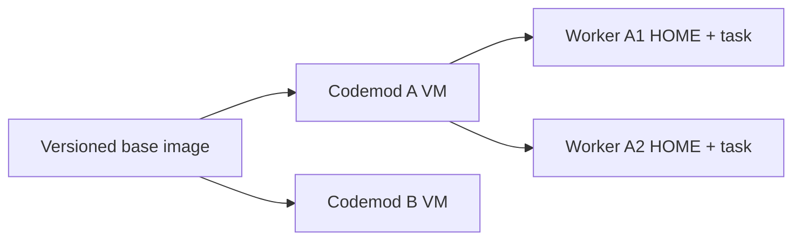

[Docs](README.md) / Understand the system

# Worker startup and timings

The harness reuses verified setup while keeping each codemod's source and runtime homes separate.

## Read startup timings

1. Select a timeline step and open **Details**.
2. Choose **4 · Activity**.
3. Read **Recorded setup timings** above saved updates.

For example, recorded evidence can show:

```text
VM boot: 1.234s
Provider connection: 0.842s
First model response: 2.310s
```

These numbers illustrate the format; they are not a benchmark. Timings report observed operation wall time. Repeated operations are summed by phase; parallel and nested operations can overlap. Their sum is not elapsed turnaround time.

| Phase | What is measured |
| --- | --- |
| Codemod startup wait | Waiting for that codemod's preparation or VM lock |
| Shared image wait / Image build | Waiting for or building the shared base image |
| VM boot | Creating and starting the guest |
| Source and worktrees | Importing source and preparing task worktrees |
| Base setup and isolation | Verifying stable helpers and preparing the guest boundary |
| Dependency setup / Capability probes / Starting baseline | The project recipe's preparation and baseline operations |
| Provider preparation / Provider connection | Verifying Muse artifacts and connecting the provider |
| First model response | From a task-turn request to its first observed model output |

A provider's acceptance acknowledgement does not count as model output. Existing worker phase totals and check durations remain available as separate evidence. None of these timings is a completion estimate.

The private diagnostics database keeps the latest 256 operation observations per codemod, including completion or interruption, source and environment identity when known, and the attempt identifier for first-response timing. Unknown identity remains unknown. A completed timing does not mean its checks passed; read the check result. Older observations are removed from this timing journal; saved checks and conversation history are unchanged.

## What is reused



- **Base setup:** Python, package configuration and the compiled offline helper are built into the image. Reconnection checks content and repairs changed helpers.
- **VM preparation:** Workers in one codemod share preparation. Different codemods can prepare at the same time. Shared image builds remain serialized.
- **Muse artifacts:** The pinned binary and bridge are recopied only when guest content differs. Credentials are never cached in the guest.

Old retained VMs with a matching saved digest migrate missing stable setup on reconnect. Their source and runtime data remain. See [VM lifecycle](sandbox.md#vm-lifecycle).

## Measured results

A disposable VM fixture exercised boot, isolation, source export and reconnect on the same host, with the image already cached:

| Version | One observed run |
| --- | --- |
| Before this batch | 17.47s |
| Versioned base setup and startup coordination | 16.48s |

This is one trial per version, showing a modest reduction. It is not a full worker-turn benchmark; it excludes model inference, project dependency setup and shared image builds. More repeated measurements are needed to establish a stable improvement.

The separate helper-corruption fixture took 171.07s including the first v2 image build. The retained-v1 migration fixture took 41.96s. These validate recovery and compatibility; their durations are not directly comparable to the cached startup fixture. [Run the disposable checks](development.md#live-checks).

## If startup is slow

Use the observed phase to choose the next step:

| Delay | Next step |
| --- | --- |
| Image build | Let the first shared build finish; subsequent VMs reuse it |
| Dependency setup | Check the project's [environment recipe](environments.md) and setup output |
| Provider preparation or connection | Inspect [provider startup](troubleshooting.md#worker-startup) and the saved failure |
| Checks | Open **2 · Checks** for command, duration and output; follow [check recovery](troubleshooting.md#checks-fail-or-take-too-long) |

Do not infer a hang from elapsed time alone. Inspect the current operation and its last observed update before retrying.
