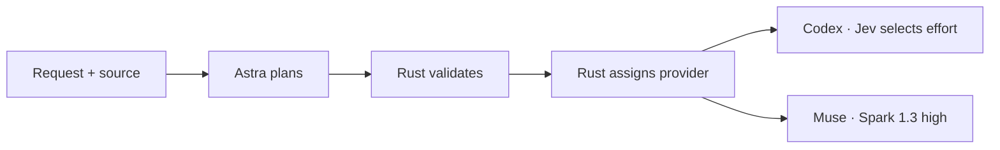

[Docs](README.md) / Understand the system

# Planning and routing

You describe the outcome. Astra xhigh inspects the project, defines contracts and splits useful work. Rust validates the plan and assigns ready tasks to available providers.

## From request to tasks



Git setup and [starting-source synchronization](git-workflow.md#keep-the-project-current) finish before planning. Edit rounds use the latest source export. A valid plan starts execution automatically.

The starting brief contains up to 120 paths across three levels, short root rules and manifest excerpts, and up to three documentation excerpts. It excludes dependencies, hidden files and external symlinks. The planner then reads relevant source, tests, docs and project rules.

## What a plan contains

| Part | Purpose |
| --- | --- |
| Summary | The requested outcome |
| Contracts | Shared interfaces, data shapes and error behavior |
| Assumptions and non-goals | Material choices and boundaries |
| Tasks | IDs, titles, outcomes, exact scopes and completion checks |
| Dependencies | Work that must finish first |
| Peer topics | Interfaces, assumptions or handoffs to coordinate |
| Provider choice | Automatic by default; capability-specific when justified |

Separate ownership permits parallel implementation against shared contracts. An interface consumer can test with a stub while a dependent integration task later checks the real components together. Shared files and genuine prerequisites require dependencies. Small changes can stay with one task.

**Ctrl+O** shows the full plan and routing decisions. Display toggles preserve your draft and queue.

### Structural validation

Rust requires 1–32 tasks, unique IDs, nonempty outcomes/checks, existing dependencies without cycles, and bounded nonempty context notes. Scopes use exact project-relative paths with no globs or parent traversal. Overlapping scopes require a dependency.

Peer links must identify existing, distinct tasks and brief topics. They are exposed in both directions, but do not block scheduling. Provider choices must match available providers; automatic choices have no provider reason, while a specific choice needs a capability reason.

These rules validate structure and declared ownership. They do not prove the plan will solve the request. Older saved plans and fixed provider assignments remain readable.

## Provider assignment

- Ready tasks default to `worker: auto`. Implementation, tests and integration can use either provider.
- Rust chooses the least loaded suitable provider across active codemods in this harness. Ties alternate using saved assignment order.
- Complexity alone does not require a provider. Capability reasons are structurally validated, not independently proven.
- Each codemod has two active slots. Connecting, running and checking all count.
- Assignments save before delivery. Retries and repairs retain provider and owner; a missing provider pauses saved work.

Load measures active work, not subscription quota. [Worker discovery](workers.md#automatic-discovery) does not test inference access or remaining usage.

## Jev task routing

[Jev](https://docs.typesafe.ai/introduction) evaluates four questions: difficulty, uncertainty, cross-component impact, and security or data-integrity risk. Rust maps its answers to Codex effort.

| Assessment | Model | Effort |
| --- | --- | --- |
| Routine, clear and isolated | `gpt-6.1-sol` | medium |
| Involved or cross-component | `gpt-6.1-sol` | high |
| Hard, uncertain or high risk | `gpt-6.1-sol` | xhigh |
| Missing configuration, timeout or invalid answer | `gpt-6.1-sol` | xhigh |

Routing happens before each Codex task turn using the project brief, plan, contracts, scope and checks. Steering stays in the current turn. Planning stays on Astra xhigh; review uses a fresh Sol 6.1 xhigh conversation; Muse uses Spark 1.3 high.

### Limits and fallback

Jev has an eight-second deadline and a **0.80 confidence floor for every question**. Rust validates options, probabilities and confidence before lowering effort. These thresholds are experimental; confidence describes distribution concentration, not guaranteed correctness.

Codex's model catalog validates the selected model/effort. Unavailable selections fall back to Sol 6.1 or the catalog default, preferring xhigh, high, then medium. Actual account access is established by inference; rejection leaves the turn retryable.

Tasks save the resolved model, effort and reason. **Ctrl+O** can show a reason such as **risk confidence 0.47 < 0.80**. SQLite retains policy version, routing input, duration and available answers/revision. Retries replace the current decision. This is diagnostic evidence, not a calibrated benchmark.

## Configure Jev

From the harness repository:

```sh
cp .env.example .env.local
```

Set your key in `.env.local`:

```dotenv
TYPESAFE_API_KEY=your_typesafe_api_key
```

Then run:

```sh
sprowt-harness setup
```

**Expected:** setup saves only that key in private `router.env`, usable from any project. Without it, Codex executors use Sol 6.1 xhigh.

Jev receives relevant project context and uses separate API billing. The key stays on the host with owner-only permissions; it is not loaded into process environment, prompts or worker configuration. Calls use TypeSafe's fixed HTTPS endpoint with redirects and environment proxies disabled. `.env.local` stays out of Git.

## Stop and retry planning

**Ctrl+R** stops or retries planning. An untouched worktree checks the remote again and starts a fresh planner conversation. Confirmed starting snapshots and source already used for execution stay fixed. History, draft and queue remain.

Reopening keeps unfinished work paused. Sending edits creates a new plan against saved source. Finished versions can use the [target-update flow](git-workflow.md#when-another-codemod-merges).

**Next:** [Execution and checks](execution.md) · [Worker communication](coordination.md)
