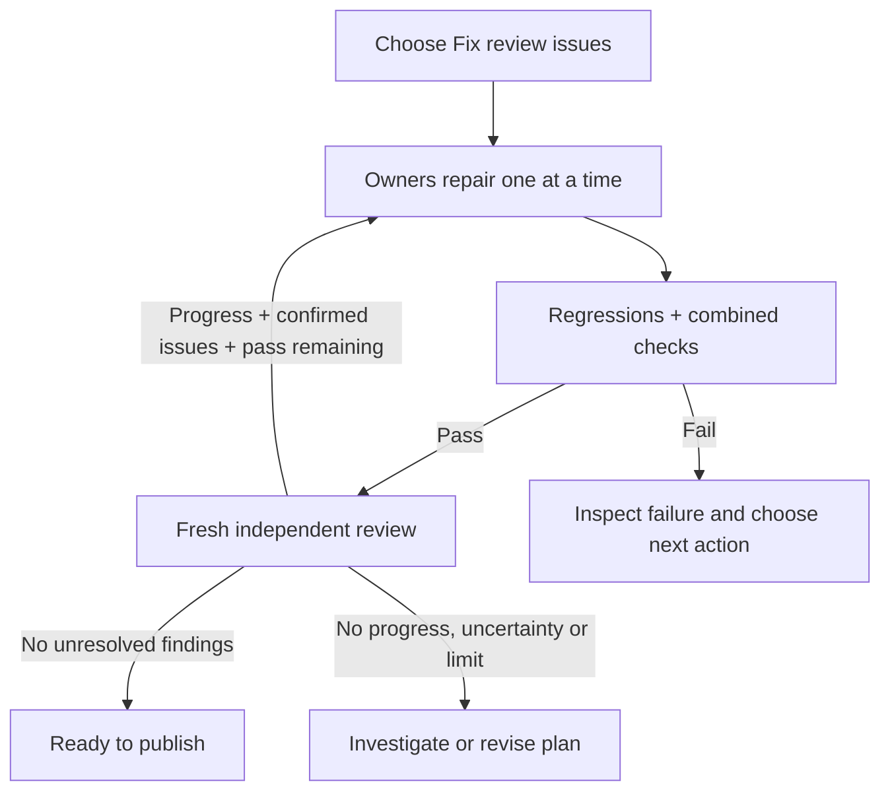

[Docs](README.md) / Use the harness

# Review and repairs

A fresh reviewer inspects the combined change after checks pass. Publication requires a clean review of the current source, including updates to an existing PR.

## Find the issues and start fixes

1. Press **Ctrl+T → 3 · Review**.
2. Read each finding's evidence, acceptance criterion and proposed fix.
3. Choose the action shown in the dock or **Ctrl+G · More**.

| Finding state | Action | What happens |
| --- | --- | --- |
| Confirmed defect | **Fix review issues** · Ctrl+G → x | Sends it to its owner with evidence and required regression coverage |
| Uncertain evidence | **Investigate findings** | Requests fresh investigation before source repairs |
| No progress or repair budget exhausted | **Revise repair plan** · Ctrl+G → v | Sends the history to the planner for a different approach |
| Clean current review | **Publish PR** or **Update PR** · Ctrl+S | Opens publication confirmation |
| Interrupted review | **Review changes** · Ctrl+E | Starts or retries review when eligible |

The same fix action remains available after a PR has been published. New local work shows **PR open · update pending** until it passes checks and review and you confirm the update.

## Understand a finding

Each finding keeps a stable **R1, R2, …** identity across wording and line changes. Open findings appear first; resolved and dismissed findings remain in history.

| Field | Meaning |
| --- | --- |
| Severity and location | Impact, file and line |
| Owner | Task responsible for the affected code |
| Triage | Confirmed, investigate or information |
| Evidence and reproduction | What failed and how the reviewer observed it |
| Acceptance criterion | Behavior required to resolve it |
| Origin | Introduced by a repair, missed earlier or unknown, with supporting evidence |
| Decision history | Prior assessments and the source each decision examined |

**Information** does not require a product change and does not block publication. **Confirmed** requires concrete reproduction evidence and an acceptance criterion. The reviewer supplies those assessments; the harness validates their structure. It does not independently execute the reviewer's initial reproduction text.

## What happens after you choose fixes

Choosing **Fix review issues** authorizes up to **two repair passes for the current plan**. Original owners, providers and scopes remain. Repairs and dependent tasks run one at a time; unrelated completed work stays saved.

Owners are instructed to:

1. Reproduce the failure before editing.
2. State the root cause and expected behavior.
3. Make a focused fix while preserving existing contracts.
4. Test the defect and adjacent boundary/error cases.

A contradictory reproduction returns to triage. After a successful pass, combined checks run and a fresh reviewer examines the entire change, including repairs and adjacent behavior. If findings close and confirmed issues remain, the remaining authorized pass can start automatically.

## What counts as resolved

Every confirmed finding adds a stable **Review regression** check. Rust independently runs the owner's submitted commands.

Closure requires both:

- All commands for that named regression passing on the current combined source.
- An explicit resolution decision from a fresh reviewer.

Omitting a finding leaves it open. Dismissal needs a recorded reason and counterevidence. Relabelling an open defect as information cannot close it. Passing tests alone do not prove correctness.

## When repairs stop

Automatic repairs stop if a pass resolves no findings, evidence needs investigation, or two passes leave issues open. Exhausting the budget never counts as success.

**Revise repair plan** passes the saved failures and finding ledger to the planner. It requests a different root-cause approach while preserving completed source, contracts and regression coverage. Your draft remains intact. A new plan gets a new budget; finding IDs and decisions remain.

The separate integration-repair handoff limit uses the same action. See [recovery budgets](execution.md#recovery-budgets) for the distinction.

## Pause, restart and stale evidence

- **Ctrl+R** pauses active work. Reopening leaves unfinished execution and review paused, even when an authorized pass remains.
- Queued instructions, steering, changed source/plans, foreground Git work and confirmation dialogs defer automatic advancement.
- Source changes invalidate the old review. Its findings remain available as saved history; obsolete responses cannot replace current results.
- Background GitHub errors stay separate from local review progress. Automatic target updates wait for a clean review; an explicit update invalidates previous evidence.

SQLite saves finding IDs, reports, decisions, fingerprints and repair budgets. Legacy findings are imported once and need fresh triage before another repair. Closing retains history; deleting the codemod removes it.

## Reviewer boundaries

The reviewer uses a fresh Sol 6.1 xhigh conversation with the request, contracts, diff, source, checks and saved findings. It reads source in the VM, can use its own temporary files, and cannot edit project source, publish or approve network access.

For a live verification command, see [development checks](development.md#live-checks).

Design references

The workflow draws on [Devin Review's triage](https://docs.devin.ai/work-with-devin/devin-review), [Cognition's coordinated agents and fresh reviewers](https://cognition.com/blog/multi-agents-working), and [evidence-led testing](https://cognition.com/blog/testing-development). Stable IDs, closure rules and repair budgets are harness policies.

**Next:** [Fix a failed check](troubleshooting.md#checks-fail-or-take-too-long) · [Publish the reviewed version](git-workflow.md#publish-a-pr)
