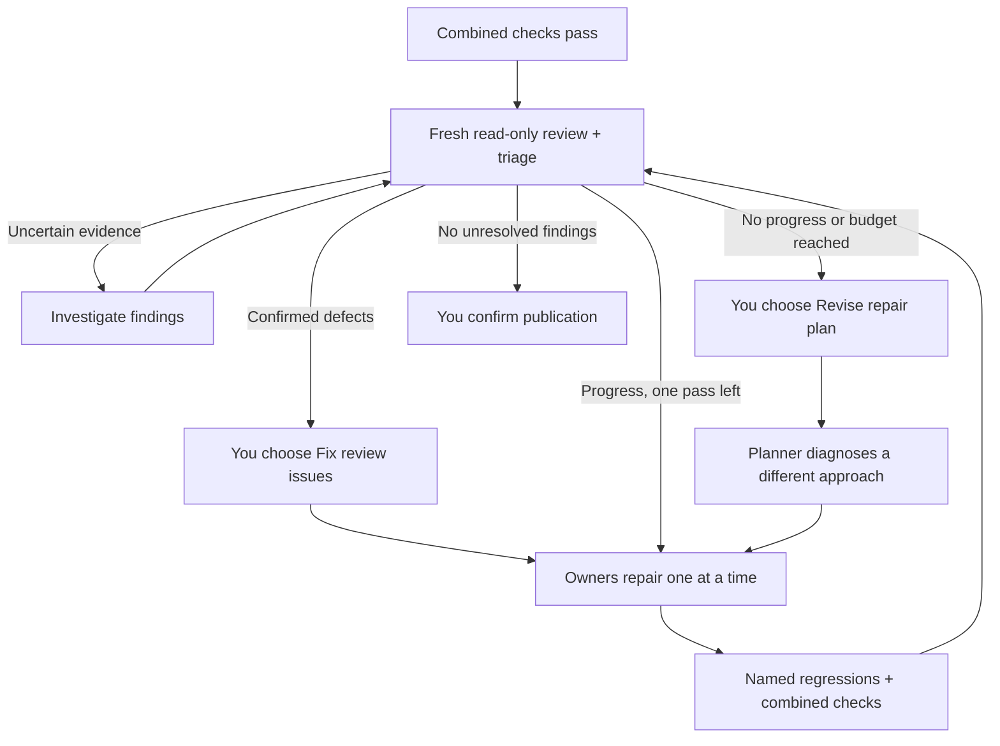

# Independent review

After combined checks pass, a fresh **Sol 6.1 xhigh** reviewer inspects the exact version. It reads the original request, contracts, diff, source, check results and saved finding history. **Ctrl+E** starts or retries review manually. Publication requires both passing combined checks and a clean review of the current source, including updates to an existing PR.



## Triage and evidence

The reviewer records triage in its review response, so there is no extra agent round just to label findings.

- **Confirmed:** a concrete contract defect with reproduction command/result and an acceptance criterion. It can go to an owner for repair.
- **Investigate:** evidence is uncertain or reproduction was unavailable. The next action is **Investigate findings**; source repairs wait.
- **Information:** an observation that does not require a product change. It does not block publication.

Each finding gets a stable **R1, R2, …** identity. Wording and line changes can reuse that ID. The reviewer distinguishes defects introduced by a repair, defects missed earlier, and unknown origin; classification needs evidence. This is a reviewer assessment, not a guarantee about causality.

Owners are instructed to reproduce the failure before editing, state its root cause and expected behavior, make a focused fix, and cover adjacent boundary/error cases. A contradictory reproduction returns to triage instead of prompting a speculative edit. Existing contracts and regression coverage remain required.

Every confirmed finding adds a stable **Review regression** check. Rust runs the submitted commands independently. Resolution requires a fresh reviewer decision and all commands for that named check passing on the current combined version. A disappearing finding is still open. Dismissal requires a recorded reason and counterevidence; relabelling an open defect as information cannot close it. The ledger retains closed findings and each decision's source fingerprint.

Reproduction text and causal classification are supplied by the reviewer. The harness validates their presence and structure; it independently executes the regression commands submitted by the owner. Passing tests alone do not establish correctness.

## Bounded repairs

**Fix review issues** authorizes up to two repair passes for the current plan. The original owners, providers and scopes remain. Review repairs and their dependent tasks run one at a time; ordinary independent implementation can still use two workers. Completed unrelated tasks retain their work and checks.

After each pass, combined checks run and a fresh reviewer examines the entire change, including the repairs and adjacent behavior. If the review closes findings and confirms remaining defects, one remaining authorized pass can start automatically. If no finding closes, evidence needs investigation, or two passes leave issues open, automatic repair stops. Neither the limit nor a worker's completion message counts as a pass.

**Revise repair plan** (**Ctrl+G → v**, or **v** in Review) sends saved failures and the finding ledger to the planner. It asks for a different root-cause approach while preserving completed source, contracts and coverage. Your composer draft stays intact. The new plan gets a new repair budget; finding IDs and prior decisions remain. The separate two-handoff integration repair limit uses this same action instead of offering another blind task retry.

Repair reuses task environments and download caches. Commands with identical arguments and budgets run once within a verification pass; changed source and later passes need fresh checks.

## What you see

**Ctrl+T → 3 · Review** shows each issue's ID, severity, owner, location, triage, origin, acceptance criterion, reproduction and decision history. Open findings come first; resolved and dismissed findings remain readable below. The dock summarizes resolved, remaining and new issues, with one useful action: fix, investigate or revise the plan. Task checks passing and independent resolution stay distinct.

A published PR can still have newer local repairs. It shows **PR open · update pending** until those changes pass checks and review and you confirm **Update PR**. Background GitHub errors remain separate from local review and repair progress.

**Ctrl+R** pauses active work. Reopening never automatically resumes a repair chain, even if an authorized pass remains. **Fix review issues** resumes eligible confirmed work. Queued instructions, steering, a changed plan/source, foreground Git work and confirmation dialogs defer automatic work. Previous evidence remains labelled as saved/outdated. Obsolete responses cannot replace current results.

SQLite saves the ledger, review reports, decisions and budgets. Legacy findings are imported once with their evidence and regression names; they need fresh triage before another repair. Closing retains history; deletion removes it with the codemod. Read-only review cannot edit, publish or grant network access. Automatic target updates wait for a clean review; an explicit target update invalidates the old result.

## Design references

The workflow adapts [Devin Review's finding triage](https://docs.devin.ai/work-with-devin/devin-review), [Cognition's guidance on coordinated agents and fresh reviewers](https://cognition.com/blog/multi-agents-working), and [evidence-led testing](https://cognition.com/blog/testing-development). Stable IDs, closure rules and repair budgets are harness policies.

## Verification

Local tests cover migration/restart, stable IDs, missing closure proof, triage, stale responses, serialized repairs, bounded continuation, publication gates and draft-preserving actions. The separate live VM check uses your Codex subscription:

```sh
cargo test independent_review_repairs_a_seeded_bug_and_rechecks_in_vm -- --ignored
```
