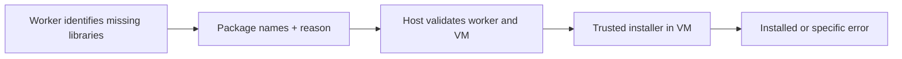

[Docs](README.md) / Understand the system

# Linux sandbox

Each executing codemod gets an Apple Container VM. Workers install project runtimes there. Host source folders and credentials are never mounted into it.

[Runtime setup](#runtimes) · [System packages](#system-packages) · [Browser checks](#browser-checks) · [Boundaries](#the-boundary) · [Network access](#downloads)

## Runtimes

Complete the [quickstart](quickstart.md) first. A valid plan starts VM execution automatically. First use builds a shared image; later runs reuse it.

The versioned image includes general build tools, Bubblewrap, Codex, mise, Python 3 and the compiled offline package helper. Stable package configuration is built once. The [project recipe](environments.md) installs and probes declared runtimes before editing. Workers can install additional requirements during their task. Runtime installations live under their own HOME:

```text
/home/sprowt/workers/<worker-id>/
```

Project dependencies live in each task worktree. `XDG_CACHE_HOME=$HOME/.cache` provides reusable downloads for workers and independent checks. Model/browser assets belong there; disposable test fixtures belong elsewhere.

Source is copied from the host into a separate guest Git repository. The controller owns `/workspace` and integration; task workers own `/tasks/<task-run-id>`. See [source filtering](execution.md#source-and-generated-files).

## System packages

Executors request missing OS libraries through `install_system_packages`, using Debian package names and a short reason. Workers can inspect project and browser requirements to choose packages.



| Boundary | Policy |
| --- | --- |
| Request | Names only; no commands, URLs, repository changes or removals |
| Download | Signed packages from official Debian 12 repositories through the proxy |
| Install | Privileged setup inside the VM, with networking blocked |
| Ordinary worker | System files remain read-only |
| Failure | Preserve source and report the cause |

The controller serializes setup with checkpoints, checks and integration. **Ctrl+R** stops setup; retry completes pending package configuration. Progress appears beside the worker. `packages.jsonl` records requests/results; `sandbox.log` retains setup output.

Trusted Debian install scripts run without host mounts or credentials. Packages requiring install-time network access fail. The syscall filter reports kernel auditing unavailable so package scripts can create users without audit/network sockets. An empty Debian-created `/root/.ssh` is allowed on reconnect; contents or links are rejected.

## Browser checks

Start the app and browser inside the **same check command** so they share loopback networking. Use a free port and stop both afterward. Missing libraries go through package setup; workers choose their runtimes and browser downloads.

Chromium needs guest Unix sockets. The pinned Codex release requires `dangerously_allow_all_unix_sockets` for this IPC. It permits guest sockets, including other guest processes, so it does not provide a worker-to-worker communication boundary. Host sockets remain unavailable; network and task-file restrictions still apply.

Use `run_task_checks` to exercise the controller environment before reporting completion. [Saved scripts](execution.md#saved-check-scripts) live read-only outside source; fixtures use `/tmp` or HOME. `/static` is a browser URL, not a writable root folder.

## The boundary

| Resource | Access |
| --- | --- |
| Task source | Assigned worktree writable; combined source and peer tasks protected |
| Runtime HOME and temporary files | Writable by that worker |
| System files | Read-only to workers; trusted setup can install packages |
| Host project, login files, SSH agent and sockets | Not mounted or forwarded |
| App ports | No published host ports; guest loopback available to checks |
| Outbound network | Domain proxy; direct and private-network destinations blocked |
| Independent reviewer | Source read-only, own HOME and `/tmp` writable, network disabled, no harness tools |
| Host planner | Read-only OS sandbox; credentials and local env files denied |

A disconnected VM stops execution; tools never fall back to the host. Inherited host apps, MCPs, plugins and hooks are disabled.

Exports preserve regular files, modes and deletions. Common credentials/dependencies are excluded; links and special files are rejected. Limits are **512 MiB per export** and **64 MiB per source file**.

## Downloads

The default allowlist covers common runtime/package sources and Playwright browser downloads, including `cdn.playwright.dev`, its Microsoft mirror and `storage.googleapis.com` redirects. System setup uses `deb.debian.org`.

### Approve a domain for one codemod

1. A worker requests exact domains and a reason using `request_network_access`.
2. The task shows **Network access needed**. Press **Ctrl+N**.
3. Press **a** to allow, **d** to deny, or **Esc** to defer.

Approval waits for the requesting turn to stop, reconnects that worker with updated policy, and queues its saved task. Source, runtime and peers remain. Other connections receive the new policy on reconnect.

Requests accept 1–8 exact public hostnames. Workers cannot approve requests or request URLs, ports, IPs or wildcards. Redirects to another blocked host need separate access. Already approved requests do not ask again.

Grants also apply to independent checks. They are inactive while the codemod is closed, restored on reopen and removed on deletion. They never modify the global policy.

### Configure the global allowlist

The host-only file is:

```text
~/Library/Application Support/sprowt-harness/network.json
```

It contains a JSON list of hostnames. For example, this fragment illustrates a domain and subdomain pattern:

```json
["example.org", "*.example.org"]
```

Add entries to your existing list rather than replacing required package hosts with this example. Wildcards are available only in this manually managed global file. `*.example.org` covers subdomains.

Existing policies survive upgrades, so newly added default domains may need to be added manually. Quit and reopen, then resume to reconnect with manual policy changes. Per-codemod approvals reconnect automatically.

Allowed services can receive data. Domain filtering does not guarantee that data cannot leave the VM.

## VM lifecycle

| Event | Result |
| --- | --- |
| Task, review or repair | Reuse the current VM and task dependencies |
| Publish | Retain VM and worktree for edits |
| Replacement plan | Retain VM/runtime caches; remove retired task folders and check scripts |
| Quit | Stop VM and retain its disk |
| Close | Save source/task branches, then delete VM and runtime data |
| Reopen closed work | Restore source; create a fresh VM when explicitly resumed |
| Delete | Remove VM and local codemod data |

Reconnection clears leftover guest processes. Shared images and the container service remain for reuse. A task Git bundle preserves source branches, not runtime installations.

VM preparation is shared within one codemod. Different codemods can prepare concurrently; building the shared image remains serialized. Cancelling a waiting worker leaves the preparing worker running.

Existing VMs from the previous image remain usable when their saved image digest matches. Reconnection checks the stable helper content and migrates missing Python through signed package setup. It retains source and runtime data. Unknown images or changed digests still stop reconnection.

See [startup timings](performance.md#read-startup-timings) to distinguish preparation from model response time.

Older pre-VM unfinished work enters Linux only on explicit run, with old host check results cleared. Completed snapshot work can be adopted into Git. A missing or altered VM blocks reconnect and preserves the last exported source.

This backend runs Linux; native macOS/iOS builds need a different backend. It uses experimental [Codex execution interfaces](https://github.com/openai/codex/tree/rust-v0.159.2/codex-rs/exec-server).

**Next:** [Verify the boundary](development.md#live-checks) · [Inspect local files](local-state.md)
