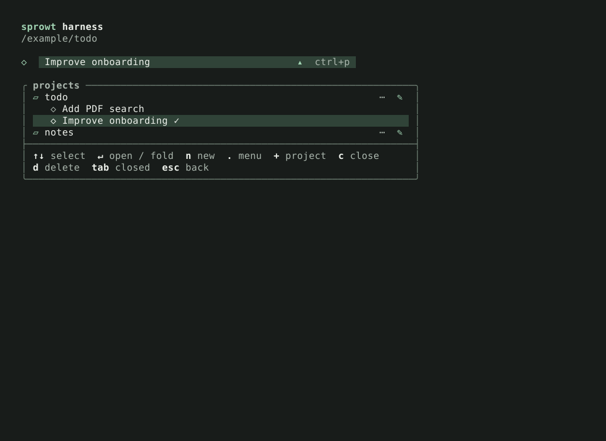

[Docs](README.md) / Use the harness

# Terminal guide

The workspace has five views: **Conversation**, **Changes**, **Checks**, **Findings** and **Agents**. The dock keeps your draft and next action available while you inspect evidence.

[Navigation](#switch-workspace-views) · [Details](#details) · [Next action](#understand-the-dock) · [Keyboard reference](#keyboard-reference) · [CLI](#commands)

Choose the shared light or dark theme with **Ctrl+G → A · Appearance**. See [Appearance](appearance.md) for system behavior and keyboard controls.

## Read the screen

*Rendered terminal layout with sample tasks and results.*

| Area | Purpose |
| --- | --- |
| **Codemod selector** | Switch between saved changes |
| **Workspace** | Conversation, changes, checks, findings or agents |
| **Dock** | Current state, the next useful action and your message |

Each view uses the available width. **Conversation** shows the request once and adds numbered plan tasks when they exist. Task details contain file scopes, dependencies, required checks and observed preparation receipts.

The header's **◇** selector opens the project accordion with **Ctrl+P**. Click a project row or press **Enter** to fold or expand its codemods. Press **N** for a new codemod in the focused project, **.** for its menu, or **+** to open another folder. The planner supplies each new codemod's short title; its complete request stays in **Conversation**.

Actual terminal output with disposable example projects.

The project menu has **X · Remove from sidebar**. This preserves its folder, saved work and running agents; reopening the folder restores the entry. See [project removal](codemods.md#remove-a-project-from-the-sidebar).

Switching projects keeps their agents running. Background projects show **•** while working or **!** when they need attention. Select the project to inspect its work or respond to a request. Quitting stops all projects owned by that terminal session.

The header shows **‹ Back Alt←** and **› Forward Alt→** when a destination is available. Click an arrow or use its shortcut to revisit a codemod or unsent creation. At narrow widths, the controls show the glyph and shortcut. [Navigation history](codemods.md#create-and-manage-work) preserves both drafts and retains each project's history until you quit. Finish or cancel an open confirmation before navigating; read-only inspections are safe to leave.

## Read the evidence

Click a tab, or press **Tab** to explore and choose **1** through **5**.

| Tab | Shows |
| --- | --- |
| **1 · Conversation** | The request, numbered plan tasks and messages; earlier updates stay in saved history |
| **2 · Changes** | Access to the current diff when available |
| **3 · Checks** | Saved setup failures and observed task results, with failed checks first |
| **4 · Findings** | Review findings, evidence, proposed fixes and GitHub PR feedback |
| **5 · Agents** | Worker identities, state and recorded startup timings |

Use **[ / ]** to move between review findings. **e** expands command evidence. Selecting a main tab clears a task-specific inspection and shows that view for the whole codemod.

Letters and numbers type normally when the composer is focused.

## Switch workspace views

1. Press **Tab** to explore the workspace.
2. Choose **1–5** to switch views, or click a tab.
3. Use **↑/↓**, **Page Up/Down** and **Home/End** to scroll.
4. Press **Tab** or **Esc** to return to your draft.

Click a numbered task to inspect it. **←** or **Esc** returns from task details; selecting a main tab shows the whole codemod. Opening evidence never starts a repair or publishes.

### Scroll and return to current work

Use the wheel or trackpad over the workspace or composer. Each workspace view remembers its scroll position; the composer scrolls its own draft. Keyboard scrolling uses **Page Up/Down** or **Fn+↑/↓** on Mac.

**Ctrl+L** returns to Conversation and resets its scroll position. Your draft stays intact.

### Read task progress

Conversation shows numbered tasks with short outcomes and dependencies. Select a task for its worker, model, latest update, file scope and checks. **Ctrl+T** also opens a keyboard-accessible task list when there are no findings or combined failures to inspect.

Keep a repair selected as it finishes: its evidence changes to the completed result while your selected tab, focus and draft stay in place.

**Latest update** belongs to the current attempt. Earlier narration remains in saved history. In Conversation, click **Saved history** or press **h** while exploring to show older messages. Worker elapsed time measures the current connected turn; last activity measures observed events. Neither is a completion estimate or proof of progress.

## Details

Choose **Inspect** or press **Ctrl+T** to open the full view that matters now. Each view includes all tasks and results; **Esc** or **Ctrl+T** returns to the workspace.

| View | What to look for |
| --- | --- |
| **Tasks** | Status, owner, model and dependencies; Enter opens one task |
| **Checks** | Failed checks first, then passing groups and commands not run |
| **Review** | Finding IDs, severity, owner, evidence, proposed fix and decision history |
| **Activity** | Time by phase, failed attempts, worker updates and handoffs |

Details opens Review when findings need attention, Checks after a combined failure, and otherwise Tasks. Before tasks exist, it opens Activity. Opening evidence does not start work.

| Evidence label | Read it as |
| --- | --- |
| **✓ passed** / **! failed** / **· not run** | Observed command result; a grouped check passes only when every command passes |
| **Earlier task report · before combined checks** | The worker's success predates the combined result |
| **Saved results** after a source change | Historical evidence; the current version still needs verification |
| **Observed worker time** | Time by phase across restarts/plans; concurrent workers count separately and offline gaps are excluded |

Press **e** to expand commands, full preparation output, elapsed time and limits. Saved setup failures remain visible in the dock and Checks after restart. Choose **Inspect failure** to open the affected task. Worker narration and elapsed time do not prove progress.

Failed tasks include recovery guidance when the cause is known. Three attempts with identical saved failure evidence recommend **Revise repair plan**, carrying that history forward. New checks and review are still required.

### Inspect a task

Select it in Tasks and press Enter. You can read its latest update, checks, dependencies, unanswered questions, network requests and recovery context.

| Key | Action |
| --- | --- |
| `r` in Tasks | Retry the selected failed task |
| Ctrl+R in task details | Retry that task |
| `h` | Open this task's activity |
| `a` | Open all activity |
| `e` | Expand evidence |

A targeted retry preserves completed peers and waits if the configured worker slots are occupied. Older messages without a saved task identity remain in all activity.

### Inspect the plan

**Ctrl+O** opens contracts, assumptions, task outcomes, dependencies, scopes, coordination topics, checks and routing. Press it again to return to the workspace. Plans use numbered tasks; the numbering follows display order.

## Choose workers

**Ctrl+G → w** opens the [worker team](workers.md#choose-a-worker-team) for this codemod or creation draft. Select planner and reviewer models and execution rows with counts. The same saved settings appear in the macOS app. Changes affect new assignments; current work continues.

## Understand the dock

The first row names the current state. Supporting rows distinguish implementation, checks, review and publication. When you need to act, one recommended button appears beside the state. Click it or use its displayed shortcut.

| You see | Next step |
| --- | --- |
| Working or recovering | Follow progress; no action is needed |
| Answer needed | Reply when the composer shows **Answer #ID** |
| Network access needed | **Ctrl+N**, inspect the domains, then allow or deny |
| Task needs attention | Inspect its evidence, then retry that task |
| Combined checks need attention | **Fix failed check**, or rerun saved checks from More |
| Confirmed review findings | **Fix review issues** |
| Uncertain review evidence | **Investigate findings** |
| Repairs stalled or budget exhausted | **Revise repair plan** |
| Review interrupted or outdated | Start or retry review when checks are current |
| Ready to publish | Inspect the diff, then **Publish PR** |
| PR open · update pending | Finish checks and review, then **Update PR** |
| Paused by you | Resume when ready |
| Closed | Reopen saved work |

Successful combined checks normally start review automatically in an active session. Reopening or pausing leaves unfinished work idle. The exact [review policy](review.md) determines whether another repair pass can continue.

Background GitHub sync failures have a separate warning. **Ctrl+U** retries sync; **Ctrl+G → s** shows its full error. This warning does not replace the local task or review state.

### Write a message

The composer starts with four rows and grows to eight, then scrolls. Wrapped text and blank lines count. On short terminals it shrinks to keep controls visible.

When creating a codemod, **F2 · Format** opens Markdown helpers for heading, bold, italic, bulleted list, checklist, inline code and code block. A `/` on an empty line opens the same menu. **↑**, **↓** and **Enter** choose a format; **Esc** cancels and leaves the slash intact. Typing a path such as `/Users/...` closes the menu without changing the path. **Ctrl+Z** undoes creation edits; **Ctrl+Shift+Z** or **Ctrl+R** redoes them.

Use the terminal application's system dictation if it supports it, or paste a dictated request. Multiline paste inserts the whole request and preserves the draft; it never acts as Enter. Sprowt does not capture microphone audio in the terminal.

**Enter** performs the action named beside the composer: create, answer, request edits or queue for the next pass. It never activates the dock's recommendation. **Ctrl+J** inserts a newline. See [messages and steering](codemods.md#send-an-instruction).

The submit and newline controls also work by click. **Inspect** opens full Details; **More** opens all available actions. Your draft stays intact while navigating.

## Keyboard reference

Shortcuts are contextual. **Ctrl+G · More** lists actions available in the current state, grouped into Work, Inspect, Codemod and Remove.

| Key | Action |
| --- | --- |
| Tab / Shift+Tab | Switch focus between composer and workspace |
| ↑↓ / Page Up/Down | Scroll the workspace while exploring |
| 1–5 while exploring | Conversation / Changes / Checks / Findings / Agents |
| h in Conversation while exploring | Show or hide saved history |
| [ / ] in review evidence | Previous / next finding |
| e while exploring | Expand command evidence |
| Ctrl+L | Return to Conversation at the top |
| Home / End | Top / bottom of the workspace while exploring |
| Ctrl+J | Newline in composer |
| F2 | Format menu in new codemod composer |
| Ctrl+Z | Undo in new codemod composer |
| Ctrl+Shift+Z / Ctrl+R | Redo in new codemod composer |
| Ctrl+T | Open Details / return to conversation |
| Ctrl+O | Toggle plan details |
| Ctrl+G | More actions |
| Ctrl+R | Pause, resume or retry relevant work |
| Ctrl+S | Review and confirm PR publication or update |
| Ctrl+E | Start or retry independent review |
| Ctrl+D | View diff when available |
| Ctrl+Q | Manage pending instructions |
| Ctrl+N | Decide a pending network request |
| Ctrl+P | Browse projects and switch or manage codemods |
| Alt+← / Alt+→ | Back / forward through codemods and creation |
| Ctrl+U | Sync project and check target updates |
| Page Up / Down | Scroll the focused view |
| Esc | Back; from the composer, quit |
| Ctrl+C | Quit |

**Ctrl+G → x** means press Ctrl+G, release it, then press `x` in More.

| Letter in More | Action, when available |
| --- | --- |
| `x` | Fix a failed check or review issues |
| `v` | Revise a stalled repair plan |
| `r` | Retry the failed task |
| `i` / `f` / `s` | Review findings / failure / sync details |
| `n` / `c` / `d` | New / close / delete codemod |

Letters type normally in the composer. Close, delete and publication keep their confirmations. The [queue](codemods.md#manage-the-queue) has its own shortcuts.

## Commands

| Command | Result |
| --- | --- |
| `sprowt-harness` | Open the current project |
| `sprowt-harness setup` | Configure optional host-only Jev routing |
| `sprowt-harness projects` | List saved sidebar projects as JSON without starting workers |
| `sprowt-harness projects --remove PROJECT_ID` | Hide one sidebar entry and keep its files and saved work |
| `sprowt-harness --no-motion` | Disable animation |
| `sprowt-harness --closed-worktree-days 0` | Keep closed worktrees indefinitely; default is 30 days |
| `sprowt-harness --help` | Show CLI help |
| `sprowt-harness --version` | Show the harness version |

## Layout and companion

The workspace uses the full content width. Tabs wrap in narrow terminals. Resizing preserves the selected view, task and draft and clamps scroll positions.

Headings, spacing, contrast and padded buttons improve readability within the terminal grid. To enlarge the font itself, use your terminal app's font or zoom settings.

Messages stay left aligned, with one blank row between them. User messages use `>` and a subtle background; agent messages identify provider and role. Menus and confirmations use a consistent compact layout. Empty lists are labelled explicitly.

The Sprowt companion uses an 8-column, 4-row area of terminal cells. It is curious while idle, thoughtful while planning, focused during work, happy when ready and still when blocked. Its silhouette stays fixed. `--no-motion` also disables entrance animation.

On exit, normal input, mouse, paste handling and the previous terminal screen are restored.

The [native macOS workspace](macos.md#find-the-same-work-in-the-terminal) exposes the same task evidence, checks, changes, queue and contextual actions. Close the terminal interface before opening the same project in the app.

**Next:** [Manage codemods](codemods.md) · [Read review findings](review.md) · [Troubleshoot a failure](troubleshooting.md)
