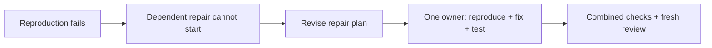

[Docs](README.md) / Use the harness

# Troubleshooting

Start with the state in the dock. **Ctrl+T** opens its evidence; **Ctrl+G** lists available actions. Saved worker narration can describe an earlier attempt, so compare it with the current check or review result.

## Find the symptom

| Symptom | Start here |
| --- | --- |
| Startup cannot prepare Muse, or asks for a different Codex version | [Worker startup](#worker-startup) |
| Muse disconnected, returned no report or delivery is unknown | [Muse stopped](#muse-stopped) |
| Setup or a capability probe fails before editing | [Project preparation](#project-preparation-fails) |
| A check fails, times out or never finishes | [Checks](#checks-fail-or-take-too-long) |
| A tests-only task blocks the production fix | [Revise the diagnostic task](#a-reproduction-is-blocking-its-repair) |
| Review keeps finding issues | [Review](#review-is-not-converging) |
| GitHub error while local work continues | [GitHub and sync](#github-and-sync-errors) |
| Task changes conflict | [Conflicts](#task-changes-conflict) |
| Download domain is blocked | [Network access](#a-download-is-blocked) |
| Reopened work is idle | [Resume](#reopened-work-does-not-start) |

## Worker startup

Codex requires the [supported CLI version](workers.md#supported-versions). Sprowt manages its own tested Muse release, so your standalone Muse can be older or newer. Both providers need a local account login.

In a host terminal, inspect installed versions:

```sh
codex --version
sprowt-harness --version
```

The standalone `muse --version` can differ from Sprowt's managed release. You do not need to downgrade it.

1. Install the supported Codex CLI version.
2. Sign in using the [login instructions](workers.md#login).
3. If the adapter pin changed, reinstall the harness from the current repository:

   ```sh
   cargo install --path . --locked --force
   ```

4. Restart the harness from the same project.

Reinstalling does not resume paused tasks or reset repair budgets. If Apple Container is unavailable, start its service using the [quickstart](quickstart.md#1-prepare-the-workers).

### Muse preparation

| Startup failure | Recovery |
| --- | --- |
| Download failed or reached the startup limit | Restore internet access, then launch again; completed verified files are reused |
| Artifact verification failed | Retry online; Sprowt replaces only the invalid tested artifact |
| Another launch is preparing Muse | Let that launch finish, then retry if the preparation limit expires |
| Python unavailable | Install host Python 3, then restart |
| Account not signed in | Run `muse login`, then restart |
| Old harness rejects your standalone Muse version | Reinstall the current harness; managed release setup replaces the old exact-version requirement |

Once both tested binaries are cached, startup can reuse them offline. Provider inference still requires connectivity. See [automatic Muse setup](workers.md#automatic-muse-setup).

## Muse stopped

| Message or condition | Meaning | Next step |
| --- | --- | --- |
| Bridge or transport disconnected | Connection ended; source is retained | Let the one automatic reconnect finish, then inspect the task if it pauses |
| Delivery could not be confirmed | The instruction may have reached Muse | Retry through the harness so saved receipts can be checked; do not send the instruction again as a new message |
| No task report | The turn ended without a valid completion report | Inspect task Activity and retry the task; narration alone cannot complete it |
| Response allowance exhausted | Muse did not finish within its response budget | Inspect the saved work and retry; a previous report cannot verify the current attempt |
| Permanent request rejection | Provider rejected the request | Read the redacted cause; correct it before retrying |
| Authentication failure | Login needs attention | Sign in again on the host and restart the connection |

Select the failed task in **Details → Tasks**, then press **r**. Independent peers can continue. Unknown delivery stays paused until reconciled; the harness does not blindly resend it. See [Muse recovery](workers.md#muse-recovery).

## Project preparation fails

Read the saved failure in the dock or **Implementation → 2 · Checks**. Choose **Inspect failure**, or press **Ctrl+G → f**, to open the affected task. Press **e** for its full preparation output, command, elapsed time and limit. These results survive restart.

| Failure | Next step |
| --- | --- |
| Invalid runtime version or setup command | **Revise repair plan** with the failed recipe and evidence |
| Download denied | **Ctrl+N** to inspect the requested domain |
| Download progresses but reaches the setup limit | Request edits with an explicit longer setup budget, up to 600 seconds; existing plans keep their declared limit |
| Setup succeeds, capability probe fails | Check the actual runtime/browser startup error; installation alone is insufficient |
| Only baseline tests fail | The worker can proceed with that starting failure recorded |
| Preparation changes source or a lockfile | Correct the recipe so setup leaves source unchanged |

See [the recipe example and setup budgets](environments.md#recipe-fields). Keep the project recipe in sync with any accepted correction. Baselines and completion checks retain their own limits.

## Checks fail or take too long

Open **Ctrl+T → 2 · Checks**, then press **e** for the saved command, output, elapsed time and limit.

| Evidence | Appropriate action |
| --- | --- |
| Assertion failure in the current combined source | **Fix failed check** returns it to the recorded owner |
| Temporary external failure; command remains valid | **Retry final checks** reruns without source edits |
| Executable missing | Allow the bounded environment recovery; inspect setup if it fails again |
| Inner test timeout before the command limit | Repair the test lifecycle or its measured budget, preserving assertions |
| Commands marked **not run** | Resolve the earlier failure; they were skipped, not passed |
| Automatic repair limit reached | **Revise repair plan** with the saved evidence |

A worker saying “all tests pass” describes its reported result. The controller's later combined check can still fail on newer integrated source.

Checks start in fresh processes. Earlier shell exports and background servers are not retained check setup. A browser check must start and clean up its own server, wait for the correct response and use a writable fixture directory. `/static` is a URL path, not a temporary filesystem location.

The command budget defaults to 30 seconds and can be set to 1–180 seconds. Raising the outer limit cannot fix a shorter inner deadline or a deadlock. Inspect the blocked operation first. See [repeatable checks](execution.md#write-repeatable-checks).

## A reproduction is blocking its repair

Choose **Revise repair plan** when a tests-only prerequisite fails and its production repair is waiting. The revised plan keeps the reproduction and gives one owner responsibility for the fix and its test.



Completed source and regression assertions stay intact. See [diagnostic recovery](execution.md#a-diagnostic-task-blocks-its-repair).

## Review is not converging

Open **Details → Review** and compare the stable finding IDs. A new issue can be a regression from a repair, an earlier missed defect or uncertain evidence; the reviewer must distinguish these with evidence.

**Fix review issues** authorizes at most two passes. No progress, uncertain evidence or an exhausted budget stops automatic work. Choose **Investigate findings** or **Revise repair plan** as offered. Completed source and the finding history stay saved.

An old review cannot be used as current proof. If it says **Awaiting fresh review**, checks may have passed while independent resolution is still pending. See [review closure](review.md#what-counts-as-resolved).

## GitHub and sync errors

A background sync failure is a separate warning. Local tasks and review can continue. Press **Ctrl+G → s** for the full error and **Ctrl+U** to retry that check after connectivity or authentication is restored.

From the affected **project root**, inspect local state and GitHub authentication:

```sh
git status --short --branch
gh auth status
```

If authentication is missing or invalid:

```sh
gh auth login
gh auth setup-git
```

**Expected:** `gh auth status` confirms an active account. A successful login does not prove that GitHub is reachable or that the account can access this repository; inspect the saved sync error too.

For failed foreground publication, use its saved retry action. Git checkpoints remain available; publication progress is recorded before success appears.

If history diverged, local edits overlap, or Git is already mid-operation, resolve that project condition first. The harness does not force-push, rebase or discard edits to make sync succeed. See [Git workflow](git-workflow.md#keep-the-project-current).

## Task changes conflict

Both versions and non-conflicting changes are saved. A text conflict within the owner's scope gets one automatic resolution attempt per task and plan. Repeated, binary, rename, deletion or out-of-scope conflicts pause.

Open the task's Details for paths, owners and attempt count. Retry a paused task when the conflict can be resolved within its scope, or send edits to revise the plan. Do not delete its workspace to clear the error. See [conflict recovery](execution.md#task-conflict-recovery).

## A download is blocked

Press **Ctrl+N** to see exact domains and the reason. **a** approves for this codemod; **d** denies; **Esc** leaves the request pending. Approval reconnects the affected worker and queues its retry. Other workers continue.

The request does not change the global allowlist. See [downloads](sandbox.md#downloads) for configuration and limits.

## Reopened work does not start

This is expected for unfinished work. Reopening restores source, history, draft and queue; **Ctrl+R** explicitly resumes eligible work. A prior user pause and consumed recovery budgets remain saved.

If a codemod was closed, its next execution creates a fresh VM and may need to restore dependencies. Quitting instead retains the stopped VM disk. See [retention](local-state.md#what-survives).

## Evidence to keep when reporting a problem

Copy this outline and fill it from **Details → Checks / Activity**:

```text
Visible state:
Task or finding ID:
Failed command:
Observed error and elapsed time:
Source changed since this result? Yes / No / Unknown
Action tried and what happened:
```

Redact secrets and private project content before sharing. [Metadata-only tool logs](tools.md#progress-and-activity) can help establish the sequence.
