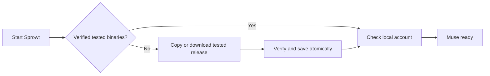
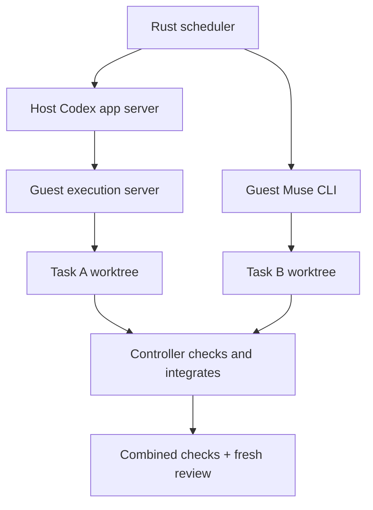
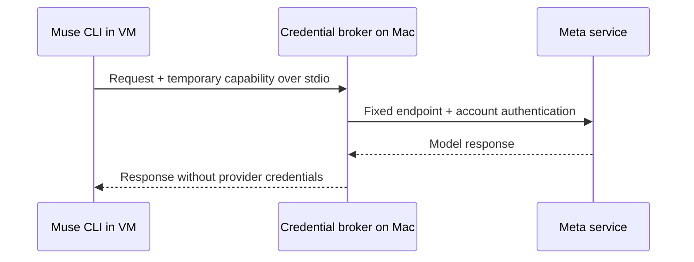

[Docs](README.md) / Understand the system

# Workers

Choose Codex or Muse models for planning, execution and independent review. Execution workers share the codemod's Linux VM with separate conversations, worktrees and runtime homes.

[Worker team](#choose-a-worker-team) · [Quota fallback](#quota-fallback) · [Versions](#supported-versions) · [Automatic Muse setup](#automatic-muse-setup) · [Login](#login) · [Execution paths](#two-execution-paths-one-scheduler) · [Muse recovery](#muse-recovery)

## Choose a worker team

In the macOS app, open **More → Workers**, or **Workers** in the creation editor. In the terminal, use **Ctrl+G → w**. Choose a model and effort for the planner and reviewer, then add execution rows and counts.

For example, one Codex executor and two Muse executors allow **three simultaneous execution workers**. Connecting, running and checking consume that limit. A planner and reviewer use their separate role selections. The total execution count can be 1–16; increasing it does not increase the [host VM resource budget](performance.md#vm-resource-budget).

**Save team** applies to new assignments. Running workers keep their model and continue uninterrupted. Reducing the limit waits for existing work to finish. Settings in the creation editor belong to that project's next codemods, so the planner can be selected before its first run. Cancel preserves the saved team, composer draft and caret.

The terminal dialog uses **↑↓** for rows, **Tab** for count/model/effort, **←→** to change a value, **+ / −** to add/remove an execution row, **r** to refresh models, **s** to save and **Esc** to cancel.

**Refresh models** queries the signed-in CLIs without starting inference. Every catalog model and supported effort is selectable for every role, including Muse Wonder. If discovery fails, the previous catalog remains visible with an error. A selected model is never silently replaced because it disappeared from the catalog; refresh and choose a supported model. Catalog presence does not establish account entitlement.

Codemods without saved worker settings keep their existing model pins, two-worker scheduler and Jev routing. Saving an explicit team replaces those defaults for future assignments.

## Quota fallback

An explicit provider quota error stops the affected attempt before another worker starts. The controller tries another model already selected in the same team, including role selections, while preserving the role, task checkpoint, accepted instructions and acknowledged mail. A task's declared provider requirement still applies. The total execution limit remains unchanged.

Cooldowns save by provider quota bucket, with model scope and reset time when supplied. They are shared across projects using the same database and survive restarts. Healthy usage observations clear only the corresponding older cooldown. Muse's optional last-observed usage snapshot can be absent or stale; unknown usage is not proof of available quota. An eligible selected model may still reject allocation, in which case its explicit quota signal prevents repeated attempts until reset or refreshed evidence.

Authentication failures, network errors, ordinary rate limiting and generic HTTP 429 responses do not trigger quota substitution. Ordinary retries keep the existing worker. When delivery is uncertain, work pauses for receipt recovery instead of replaying the instruction on another provider. Pause and Close also prevent replacement workers from starting.

If no selected compatible worker can continue, work stays saved. Open **Workers** to select another model or **Refresh models** after quota resets, then resume paused work. No unselected model, paid credit reset or broader permission is used.

## Supported versions

| Component | Supported value | Source of the pin |
| --- | --- | --- |
| Codex CLI | **0.159.2** | [`src/sandbox.rs`](../src/sandbox.rs) |
| Muse CLI, optional | **1.4.7-R6101.1**, managed by Sprowt | [`src/muse_release.py`](../src/muse_release.py) |
| Host platform | Apple silicon, macOS 26+ | Apple Container backend |
| Muse host adapter | Python 3 | Host stdio transport |

CLI protocols affect isolation and recovery, so releases are tested and pinned. Updating the harness can advance its Muse release; updates to your standalone Muse CLI do not change Sprowt's adapter or worker binaries.

## Automatic discovery

Run `sprowt-harness` normally. Startup checks Codex's version, prepares Sprowt's tested Muse release when available, and checks local account status.

| Installed providers | Result |
| --- | --- |
| Supported, signed-in Codex | Required baseline |
| Muse absent, no managed copy | Codex-only execution |
| Muse installed, including an older or newer release | Sprowt prepares its own tested release; joins the pool after login |
| Verified managed Muse cached, standalone CLI absent | Reuses the managed release; requires a saved Muse account login |
| Release cannot be prepared, or provider signed out | Startup stops with a download, verification or login action |

Discovery does not start inference or a VM, copy credentials, or check provider access and usage limits. Release preparation can download public binaries. Saved tasks retain their provider; a saved Muse task needs Muse when resumed.

## Automatic Muse setup

Sign in once with your standalone Muse CLI, then start Sprowt:

```sh
muse login
sprowt-harness
```

**Expected:** startup checks Muse, prepares the tested Mac and Linux binaries, then opens the terminal app. A verified installed Mac binary is copied into Sprowt's private cache; missing binaries are downloaded from Meta and checked against pinned sizes and SHA-256 hashes.



Preparation has a **10-minute startup limit**. Completed files survive an interrupted download; the next launch reuses them and retries the missing file. Concurrent launches share a preparation lock.

The cache works offline once both binaries are verified. Sprowt leaves your standalone Muse installation unchanged and never adopts an untested newer release automatically. A corrupt cache entry must be replaced with the exact tested artifact; it is not used as a fallback.

**Next:** [Startup recovery](troubleshooting.md#worker-startup) · [Cache location](local-state.md#storage-layout)

## Login

Codex requires a file-backed ChatGPT login; Keychain-only login is unsupported:

```sh
codex -c 'cli_auth_credentials_store="file"' login
```

For supported Muse, sign in on the Mac:

```sh
muse login
```

The host resolves that account login. No separate Meta API key is used, and the provider header stays in host memory. Startup prepares the verified Linux binary. New VMs already include Python; older retained VMs receive it through signed package setup.

Automatic login refresh is not implemented. After changing login or installed providers, restart the harness. See [startup troubleshooting](troubleshooting.md#worker-startup).

## Roles

| Role | Connection | Default for codemods without saved settings |
| --- | --- | --- |
| Planner | Host Codex read-only, or selected Muse in read-only VM | Astra xhigh |
| Codex executor | Host app server + guest execution server | Sol 6.1 medium, high or xhigh |
| Muse executor | Full Muse CLI inside the VM | Muse Spark 1.3 high |
| Independent reviewer | Fresh conversation, reads VM source | Sol 6.1 xhigh |
| Publication writer | Separate read-only host Codex call | Sol 6.1 low |

[Jev](planning.md#jev-task-routing) selects Codex executor effort only when no explicit team is saved. The reviewer cannot edit source, publish, approve access or call harness tools. Read-only Muse roles use only the local model transport; external network access is denied.

The [publication writer](git-workflow.md#commit-and-pr-text) drafts commit and PR text from the reviewed diff. You confirm publication in the terminal.

Every new or resumed agent receives the shared [coding skill policy](skills.md#harness-agents). Coding roles read their pinned instructions from a read-only bundle. Ponytail uses full mode, pstack loads by task, and review checks correctness and structural quality together. Native plugin discovery stays disabled.

## Two execution paths, one scheduler



Both providers can implement, test and integrate. Saved teams allocate ready tasks to their requested model counts. Codemods without settings retain the two-slot scheduler, balancing provider load across codemods with alternating ties. Ordinary retries retain their owner; explicit quota exhaustion follows the fallback rules above. Dependencies still control readiness.

Each worker has its own cancellation signal and runtime HOME. Connecting, running and checking occupy slots; idle identities do not. Independent task preparation and `run_task_checks` commands can overlap in fixed task sessions. Checkpoints, source replacement, integration and package mutations remain serialized. [Execution waits](performance.md#overlap-independent-task-work) describes the boundary.

On each Muse connection, the host verifies the pinned binary and checks the guest binary and bridge against their actual SHA-256 content. Matching files are reused; missing or changed files are recopied. Provider credentials stay on the host. See [recorded startup timings](performance.md) to inspect preparation and response delays.

### Current task handoff

New and resumed executor conversations receive the same fixed tool, report and verification policy. Each assignment then sends the current task, exact checks and attempt ID, shared contracts, ownership/dependency table and relevant peer topics. Saved scripts, repair commands and observed failures stay attached to that assignment. The original goal remains in the conversation instructions; the full saved plan and routing input remain available to the controller.

### Isolation

Codex's trusted host process handles inference and sends executor tools into the VM. Inherited apps, MCP servers, plugins, hooks and delegation are disabled. The planner uses a read-only host sandbox that denies credential directories and local environment files.

Muse and its children run inside the guest execution server's enforced process sandbox. Muse's internal sandbox is disabled inside that outer boundary. Executors can write their task folder, HOME and temporary files; peer task folders are unavailable. Downloads use the harness allowlist. Planner and reviewer source access is read-only, with private runtime HOME and temporary files.

### Shared tools and steering

Both providers use [mailboxes](coordination.md) and the same [tool dispatcher](tools.md). Muse receives checks, package setup, network requests and mailbox tools through a guest MCP bridge. Worker identities are bound by the host; a model cannot select another VM or invoke host publication.

Delivery saves as pending before send; acceptance saves a receipt atomically. Native conversation receipts are checked on reconnect. Unknown delivery pauses automatic retry.

An old Codex conversation lacking current tools starts fresh from saved goals, source and accepted instructions. Completed tasks, VM and transcript remain. Network approval reconnects the affected worker after its turn stops; peers continue.

## Muse model broker



| Broker limit | Value |
| --- | --- |
| Capability lifetime | One task turn, at most one hour |
| Requests per capability | 128 |
| Output allowance per request | 32,768 tokens, including reasoning |
| Allowed routes | Model catalog and streamed responses for the assigned model at fixed endpoints |
| Revocation | Turn completion or worker stop |

Redirects and other account/model routes are denied. Account authentication is verified; usage observations and explicit quota errors come from the native CLI. The bounded HTTP 429 body and allowed rate-limit headers reach that CLI so it can distinguish quota exhaustion from ordinary throttling. Raw provider credentials are withheld.

## Muse recovery

Muse keeps one native conversation per assigned task in its VM home. Stopping and retrying can reuse it while that disk remains. Quitting retains the stopped VM; closing deletes it and its native tool history.

A dropped connection gets **one automatic reconnect** to the same session. Recovery checks dispatch logs, receipts and turn status before deciding what to do.

| Evidence | Recovery |
| --- | --- |
| Same session proves an update was never dispatched | Leave it queued/in the inbox and allow work to continue |
| Active turn | Keep it running |
| Confirmed interrupted turn | Resume from saved work and context |
| Completed turn with a valid report | Proceed to independent verification |
| Unknown delivery, missing turn status or oversized history | Preserve pending data and pause |
| Second disconnect | Require explicit retry |

Session/command IDs save before submission; accepted turn IDs save before acknowledgement. An ID alone is not proof of delivery. Repeated receipt processing keeps one transcript entry and does not resend accepted steering or mail.

Recovery reads native items and paged events, up to **64 pages / 8 MiB**. A missing dispatch log or replacement session cannot clear an uncertain delivery marker.

### Bridge and provider failures

Errors distinguish provider rejection, guest exit and VM transport. Saved details are bounded and redact credentials and URLs; raw bodies, headers and process stderr are not retained. The original cause survives cleanup failures.

Messages cross the VM transport in acknowledged chunks. The receiver assembles and validates them, and drains final output after process exit, preventing large requests/history from overrunning the output buffer.

| Failure | Policy |
| --- | --- |
| Permanent HTTP 4xx | Stop automatic retries; 401 points to host `muse login` |
| 408, 429 or server failure | Native CLI bounded retries |
| Confirmed context-limit code | Fresh conversation on the next safe reconnect, rebuilt from saved work/instructions |
| Uncertain delivery | No context reset or blind resend |
| Response allowance exhausted | Pause with a specific cause, retained across reconnect |
| Missing task report | Pause; turn completion or narration is not task completion |

**Details → Tasks → r** retries one failed task. Peers continue and the retry waits for a slot if needed. Another task or edit round starts its own session. Reopening a closed codemod rebuilds context from saved source and instructions; deleted native history cannot be restored.

## Standalone diagnostics

Compatibility probes are separate from production scheduling:

| Probe | What it exercises |
| --- | --- |
| [Muse host](../examples/muse_probe.rs) | MCP/policy activation; a `BLOCKED` native-hook result is expected and not an isolation boundary |
| [Muse VM](../examples/muse_vm_probe.py) | Editing, execution, steering and sibling-read denial through the broker |
| [Full Codex VM](../examples/codex_vm_probe.py) | Linux CLI/helper, host-only login, native tools and cancellation; production still uses the host app server |

See [Development](development.md) for offline tests and selected live checks. Live probes use disposable fixtures and remove their VMs on completion or a returned error.

**Next:** [Sandbox boundaries](sandbox.md) · [Local state and retention](local-state.md)
