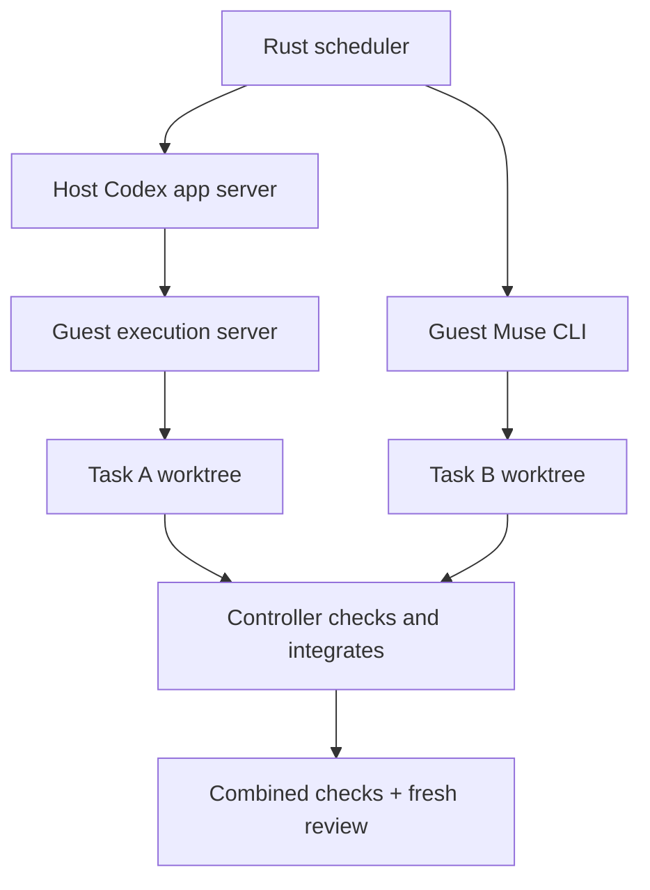
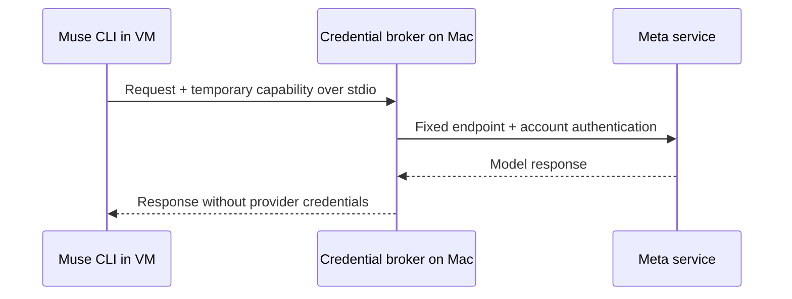

[Docs](README.md) / Understand the system

# Workers

Codex handles planning and independent review. Codex and Muse can execute tasks in the codemod's Linux VM, with separate conversations, worktrees and runtime homes.

[Versions](#supported-versions) · [Login](#login) · [Execution paths](#two-execution-paths-one-scheduler) · [Muse recovery](#muse-recovery)

## Supported versions

| Component | Supported value | Source of the pin |
| --- | --- | --- |
| Codex CLI | **0.159.2** | [`src/sandbox.rs`](../src/sandbox.rs) |
| Muse CLI, optional | **1.4.4-R5419.1** | [`src/muse.rs`](../src/muse.rs) |
| Host platform | Apple silicon, macOS 26+ | Apple Container backend |
| Muse host adapter | Python 3 | Host stdio transport |

CLI protocols affect isolation and recovery, so releases are pinned. Muse's matching Linux binary is also SHA-256 verified and privately cached. A Muse update needs a matching supported adapter and a harness reinstall.

## Automatic discovery

Run `sprowt-harness` normally. Startup checks CLI versions and local account status.

| Installed providers | Result |
| --- | --- |
| Supported, signed-in Codex | Required baseline |
| Muse absent | Codex-only execution |
| Supported, signed-in Muse present | Joins the pool automatically |
| Installed provider incompatible or signed out | Startup stops with the installed/supported version or login action |

Discovery does not start inference or a VM, copy credentials, or check remote access and usage limits. Saved tasks retain their provider; a saved Muse task needs Muse when resumed.

## Login

Codex requires a file-backed ChatGPT login; Keychain-only login is unsupported:

```sh
codex -c 'cli_auth_credentials_store="file"' login
```

For supported Muse, sign in on the Mac:

```sh
muse login
```

The host resolves that account login. No separate Meta API key is used, and the provider header stays in host memory. First use downloads the verified Linux binary; guest Python is installed through the VM package controller.

Automatic login refresh is not implemented. After changing login or installed providers, restart the harness. See [startup troubleshooting](troubleshooting.md#worker-startup).

## Roles

| Role | Connection | Model and effort |
| --- | --- | --- |
| Planner | Host Codex app server, read-only | Astra xhigh |
| Codex executor | Host app server + guest execution server | Sol 6.1 medium, high or xhigh |
| Muse executor | Full Muse CLI inside the VM | Muse Spark 1.3 high |
| Independent reviewer | Fresh Codex conversation, reads VM source | Sol 6.1 xhigh |
| Publication writer | Separate read-only host Codex call | Sol 6.1 low |

[Jev](planning.md#jev-task-routing) selects Codex executor effort only. The reviewer cannot edit source, publish, approve access or call harness tools; its network access is disabled.

The [publication writer](git-workflow.md#commit-and-pr-text) drafts commit and PR text from the reviewed diff. You confirm publication in the terminal.

Every new or resumed agent receives the shared [coding skill policy](skills.md#harness-agents). Coding roles read their pinned instructions from a read-only bundle. Ponytail uses full mode, pstack loads by task, and review checks correctness and structural quality together. Native plugin discovery stays disabled.

## Two execution paths, one scheduler



Both providers can implement, test and integrate. Two slots can hold either provider combination. Rust balances ready tasks by active provider load across codemods; ties alternate. Saved assignments and retries retain their owner. Dependencies still control readiness.

Each worker has its own cancellation signal and runtime HOME. Connecting, running and checking occupy slots; idle identities do not. The controller serializes checkpoints, checks, integration and system package setup, while model turns and ordinary commands can overlap.

### Isolation

Codex's trusted host process handles inference and sends executor tools into the VM. Inherited apps, MCP servers, plugins, hooks and delegation are disabled. The planner uses a read-only host sandbox that denies credential directories and local environment files.

Muse and its children run inside the guest execution server's enforced process sandbox. Muse's internal sandbox is disabled inside that outer boundary. It can write its task folder, HOME and temporary files; peer task folders are unavailable. Downloads use the harness allowlist.

### Shared tools and steering

Both providers use [mailboxes](coordination.md) and the same [tool dispatcher](tools.md). Muse receives checks, package setup, network requests and mailbox tools through a guest MCP bridge. Worker identities are bound by the host; a model cannot select another VM or invoke host publication.

Delivery saves as pending before send; acceptance saves a receipt atomically. Native conversation receipts are checked on reconnect. Unknown delivery pauses automatic retry.

An old Codex conversation lacking current tools starts fresh from saved goals, source and accepted instructions. Completed tasks, VM and transcript remain. Network approval reconnects the affected worker after its turn stops; peers continue.

## Muse model broker



| Broker limit | Value |
| --- | --- |
| Capability lifetime | One task turn, at most one hour |
| Requests per capability | 128 |
| Output allowance per request | 32,768 tokens, including reasoning |
| Allowed routes | Model catalog and streamed Spark 1.3 responses at fixed endpoints |
| Revocation | Turn completion or worker stop |

Redirects and other account/model routes are denied. Account authentication is verified; subscription metering is not independently exposed by the CLI. Included usage is not a measured harness guarantee.

## Muse recovery

Muse keeps one native conversation per assigned task in its VM home. Stopping and retrying can reuse it while that disk remains. Quitting retains the stopped VM; closing deletes it and its native tool history.

A dropped connection gets **one automatic reconnect** to the same session. Recovery checks dispatch logs, receipts and turn status before deciding what to do.

| Evidence | Recovery |
| --- | --- |
| Same session proves an update was never dispatched | Leave it queued/in the inbox and allow work to continue |
| Active turn | Keep it running |
| Confirmed interrupted turn | Resume from saved work and context |
| Completed turn with a valid report | Proceed to independent verification |
| Unknown delivery, missing turn status or oversized history | Preserve pending data and pause |
| Second disconnect | Require explicit retry |

Session/command IDs save before submission; accepted turn IDs save before acknowledgement. An ID alone is not proof of delivery. Repeated receipt processing keeps one transcript entry and does not resend accepted steering or mail.

Recovery reads native items and paged events, up to **64 pages / 8 MiB**. A missing dispatch log or replacement session cannot clear an uncertain delivery marker.

### Bridge and provider failures

Errors distinguish provider rejection, guest exit and VM transport. Saved details are bounded and redact credentials and URLs; raw bodies, headers and process stderr are not retained. The original cause survives cleanup failures.

Messages cross the VM transport in acknowledged chunks. The receiver assembles and validates them, and drains final output after process exit, preventing large requests/history from overrunning the output buffer.

| Failure | Policy |
| --- | --- |
| Permanent HTTP 4xx | Stop automatic retries; 401 points to host `muse login` |
| 408, 429 or server failure | Native CLI bounded retries |
| Confirmed context-limit code | Fresh conversation on the next safe reconnect, rebuilt from saved work/instructions |
| Uncertain delivery | No context reset or blind resend |
| Response allowance exhausted | Pause with a specific cause, retained across reconnect |
| Missing task report | Pause; turn completion or narration is not task completion |

**Details → Tasks → r** retries one failed task. Peers continue and the retry waits for a slot if needed. Another task or edit round starts its own session. Reopening a closed codemod rebuilds context from saved source and instructions; deleted native history cannot be restored.

## Standalone diagnostics

Compatibility probes are separate from production scheduling:

| Probe | What it exercises |
| --- | --- |
| [Muse host](../examples/muse_probe.rs) | MCP/policy activation; a `BLOCKED` native-hook result is expected and not an isolation boundary |
| [Muse VM](../examples/muse_vm_probe.py) | Editing, execution, steering and sibling-read denial through the broker |
| [Full Codex VM](../examples/codex_vm_probe.py) | Linux CLI/helper, host-only login, native tools and cancellation; production still uses the host app server |

See [Development](development.md) for offline tests and selected live checks. Live probes use disposable fixtures and remove their VMs on completion or a returned error.

**Next:** [Sandbox boundaries](sandbox.md) · [Local state and retention](local-state.md)
